<picture><source media="(prefers-color-scheme: dark)" srcset="assets/dist/hero-tech-jobs-dark.svg"><source media="(prefers-color-scheme: light)" srcset="assets/dist/hero-tech-jobs-light.svg"></picture>

<a href="#open-jobs"><picture><source media="(prefers-color-scheme: dark)" srcset="assets/dist/btn-primary-dark.svg"><source media="(prefers-color-scheme: light)" srcset="assets/dist/btn-primary-light.svg"></picture></a>

<a href="https://chromewebstore.google.com/detail/gmdkffapbfeanfecgcodocfcefldjaho"><picture><source media="(prefers-color-scheme: dark)" srcset="assets/dist/btn-extension-dark.svg"><source media="(prefers-color-scheme: light)" srcset="assets/dist/btn-extension-light.svg"></picture></a>&nbsp;&nbsp;<a href="https://jobhacki.com/login-v2"><picture><source media="(prefers-color-scheme: dark)" srcset="assets/dist/btn-account-dark.svg"><source media="(prefers-color-scheme: light)" srcset="assets/dist/btn-account-light.svg"></picture></a>

Join the JobHacki Discord community to talk about jobs with other job seekers.

<a href="https://discord.gg/RApjXmgnwA">Talk through tech jobs with others in #leads-tech.</a>

<table><tr><td align="center" valign="top"><h3>26,445</h3>open tech and software jobs in this list (latest refresh)</td><td align="center" valign="top"><h3>150</h3>freshest rows shown below</td><td align="center" valign="top"><h3>2026-11-09</h3>newest posting date</td></tr></table>

Snapshot 2026-11-09 12:20 UTC

**Hi, I'm Sophia, JobHacki's AI assistant. Pick a list, inspect a role, and follow its employer link.**

For software engineers, IT specialists, and security professionals, this list is a fresh slice of tech and software jobs taken from employers' own hiring systems. Updated Nov 9, 2026.

[Back to all 12 lists](https://github.com/Jobhacki/jobs)

 

<picture><source media="(prefers-color-scheme: dark)" srcset="assets/dist/divider-dark.svg"><source media="(prefers-color-scheme: light)" srcset="assets/dist/divider-light.svg"></picture>

## Open jobs

**26,445 open tech and software jobs seen in the latest refresh.** The table shows the freshest 150. **Last updated: 2026-11-09 12:20 UTC.** Apply links go to the employer's career page or hiring system.

<!-- JOBS_TABLE_START -->
| Role | Employer | Location | Pay | Posted | Apply |
|---|---|---|---|---|---|
| Node.JS Developer | EXL | Pittsburgh, Pennsylvania, United States |  | 2026-11-09 | [Apply](https://fa-ewjt-saasfaprod1.fa.ocs.oraclecloud.com/hcmUI/CandidateExperience/en/sites/CX_2/job/22302) |
| Mainframe Developer (Unisys OS2200) | AG Consulting Partners, Inc. | Tacoma, Washington, US |  | 2026-11-09 | [Apply](https://apply.workable.com/j/8A8CB38387) |
| Software Engineer III | candescent | IN - Bengaluru - Office |  | 2026-11-09 | [Apply](https://candescent.wd501.myworkdayjobs.com/en-US/hiring/job/IN---Bengaluru---Office/Software-Engineer-III_R0002357) |
| IT Audit, Cybersecurity & Risk Senior Consultant (Financial Services Focus) | bakertilly | 4 Locations |  | 2026-11-09 | [Apply](https://bakertilly.wd5.myworkdayjobs.com/en-US/btcareers/job/USA-MA-Tewksbury/IT-Audit--Cybersecurity---Risk-Senior-Consultant--Financial-Services-Focus-_JR108944) |
| IT Audit, Cybersecurity & Risk Senior Consultant (Financial Services Focus) | bakertilly | 4 Locations |  | 2026-11-09 | [Apply](https://bakertilly.wd5.myworkdayjobs.com/en-US/btcareers/job/USA-MA-Tewksbury/IT-Audit--Cybersecurity---Risk-Senior-Consultant--Financial-Services-Focus-_JR108943) |
| Digital Technology Professional - Software Engineering | bakerhughes | IN-MH-MUMBAI-HIRANANDANI BUSINESS PARK POWAI |  | 2026-11-09 | [Apply](https://bakerhughes.wd5.myworkdayjobs.com/en-US/bakerhughes/job/IN-MH-MUMBAI-HIRANANDANI-BUSINESS-PARK-POWAI/Digital-Technology-Professional---Software-Engineering_R169599-1) |
| Offensive Cybersecurity Engineers: Build RL Environments for AI Evaluation | terac | United States |  | 2026-11-09 | [Apply](https://jobs.ashbyhq.com/terac/342d43ab-ba49-4f68-bfbc-5edbdb097d56) |
| IT Security Engineer II | cmt | Cambridge, MA |  | 2026-11-09 | [Apply](https://job-boards.greenhouse.io/cmt/jobs/8353969) |
| Software Engineer, Backend - Base Power Platform | base-power | Austin, TX |  | 2026-11-09 | [Apply](https://jobs.ashbyhq.com/base-power/f1faeca1-0545-44d2-87e3-aa74dc88b083) |
| Senior Software Engineer - Python, ETL, Databricks, AWS | factset | 2 Locations |  | 2026-11-09 | [Apply](https://factset.wd108.myworkdayjobs.com/en-US/factsetcareers/job/India-Hyderabad-DVS-SEZ-1--Orion-B4-FL-78911-Hyderabad---Divyasree-3/Principal-Software-Engineer---Python--ETL--Databricks--AWS_R32624) |
| Senior Cloud Security Engineer | altera | San Jose, California, United States |  | 2026-11-09 | [Apply](https://altera.wd1.myworkdayjobs.com/en-US/altera/job/San-Jose-California-United-States/Senior-Cloud-Security-Engineer_R03389) |
| Software Engineer II | Domino's | Ann Arbor, MI, US |  | 2026-11-09 | [Apply](https://jobs.smartrecruiters.com/Dominos/744000160500849) |
| Software Engineer, Backend - Deployments | base-power | Austin, TX |  | 2026-11-09 | [Apply](https://jobs.ashbyhq.com/base-power/9ed279a2-a39d-4b75-bbee-bff898b448c3) |
| IT Service Desk Tier 2 (Hybrid) | usuro | Syracuse, NY |  | 2026-11-09 | [Apply](https://usuro.wd1.myworkdayjobs.com/en-US/amp_career/job/Syracuse-NY/IT-Service-Desk-Tier-2--Hybrid-_R3476-2) |
| Front End Lead Full Time | bjswholesaleclub | West Nyack, NY #0077 |  | 2026-11-09 | [Apply](https://bjswholesaleclub.wd1.myworkdayjobs.com/en-US/bjscareers/job/West-Nyack-NY-0077/Front-End-Lead-Full-Time_R261651) |
| Senior Software Engineer | marmon | Karnataka, IN |  | 2026-11-08 | [Apply](https://marmon.wd501.myworkdayjobs.com/en-US/marmon_careers/job/Karnataka-IN/Senior-Software-Engineer_JR0000046845) |
| Sr. Full Stack Software Engineer, Manufacturing Systems | SpaceX | Bastrop, TX |  | 2026-11-08 | [Apply](https://boards.greenhouse.io/spacex/jobs/8934569002?gh_jid=8934569002) |
| Sr. Full Stack Software Engineer | SpaceX | Bastrop, TX |  | 2026-11-08 | [Apply](https://boards.greenhouse.io/spacex/jobs/8934568002?gh_jid=8934568002) |
| Sr. Full Stack Engineer, Fight Software | SpaceX | Hawthorne, CA |  | 2026-11-08 | [Apply](https://boards.greenhouse.io/spacex/jobs/8934570002?gh_jid=8934570002) |
| Software Automation & Platform Engineer — Federal Health IT | rackner | Remote — United States |  | 2026-11-08 | [Apply](https://job-boards.greenhouse.io/rackner/jobs/4752573005) |
| Staff Software Engineer, Applied AI | superdial | Burlingame, CA |  | 2026-11-08 | [Apply](https://jobs.ashbyhq.com/superdial/be4efadc-d138-48fc-b284-93843bf23afa) |
| Staff Software Engineer | conga | US - Boston, MA ; US - Houston, TX |  | 2026-11-08 | [Apply](https://job-boards.greenhouse.io/conga/jobs/5273094007) |
| Software Engineer, Distributed Compute | base-power | Austin, TX |  | 2026-11-08 | [Apply](https://jobs.ashbyhq.com/base-power/5ea771cb-099f-40e7-a73f-a813494dc037) |
| Cybersecurity & Information Assurance Specialist — Federal Health IT | rackner | Remote — United States |  | 2026-11-08 | [Apply](https://job-boards.greenhouse.io/rackner/jobs/4752563005) |
| Software Engineer - Directed Energy | grvty | Albuquerque, New Mexico, United States |  | 2026-11-08 | [Apply](https://job-boards.greenhouse.io/grvty/jobs/4482808009) |
| Senior Software Engineer - Directed Energy | grvty | Albuquerque, New Mexico, United States |  | 2026-11-08 | [Apply](https://job-boards.greenhouse.io/grvty/jobs/4482781009) |
| Security Engineer (Corporate IT) | resolution | Berkeley, California |  | 2026-11-08 | [Apply](https://jobs.ashbyhq.com/resolution/3f73adc2-04ec-4d7e-be40-e43193adff6c) |
| Security Engineer (Research Infrastructure) | resolution | Berkeley, California |  | 2026-11-08 | [Apply](https://jobs.ashbyhq.com/resolution/d803b4b1-4b4a-4ea8-8ded-ae54e1e1107b) |
| Software Engineer, Design | Garage | New York City |  | 2026-11-08 | [Apply](https://jobs.ashbyhq.com/garage/17815e07-5b55-4efd-9aa8-1d33d6ec010f) |
| Software Engineer, Growth | Garage | New York City |  | 2026-11-08 | [Apply](https://jobs.ashbyhq.com/garage/5119e260-d0e4-4ad1-b264-1951f7dcc3f8) |
| Systems Administrator II | caredxinc | United States |  | 2026-11-08 | [Apply](https://job-boards.greenhouse.io/caredxinc/jobs/4459548009) |
| Software Engineering Technical Leader | cisco | Milpitas, California, US |  | 2026-11-08 | [Apply](https://cisco.wd5.myworkdayjobs.com/en-US/cisco_careers/job/Milpitas-California-US/Software-Engineering-Technical-Leader_2028826) |
| Senior Software Engineer, AI/ML Network Engineering | cisco | Milpitas, California, US |  | 2026-11-08 | [Apply](https://cisco.wd5.myworkdayjobs.com/en-US/cisco_careers/job/Milpitas-California-US/Senior-Software-Engineer--AI-ML-Network-Engineering_2026938-1) |
| Director, Data Platform Engineering | Domino's | Ann Arbor, MI, US |  | 2026-11-08 | [Apply](https://jobs.smartrecruiters.com/Dominos/744000160454149) |
| Staff Software Engineer | Walmart | (USA) AR BENTONVILLE 08098 HOME OFFICE |  | 2026-11-08 | [Apply](https://walmart.wd504.myworkdayjobs.com/en-US/WalmartExternal/job/USA-AR-BENTONVILLE-08098-HOME-OFFICE/Staff-Software-Engineer_R-2668277) |
| Senior Software Engineer (Data Engineering) | Workday | 3 Locations |  | 2026-11-08 | [Apply](https://workday.wd5.myworkdayjobs.com/en-US/Workday/job/USA-CA-Pleasanton/Senior-Software-Engineer--Data-Engineering-_JR-0111341) |
| Network Security Engineer | altera | San Jose, California, United States |  | 2026-11-08 | [Apply](https://altera.wd1.myworkdayjobs.com/en-US/altera/job/San-Jose-California-United-States/Network-Security-Engineer_R03275) |
| Senior, Software Engineer (Backend) | Walmart | Sunnyvale, CA |  | 2026-11-08 | [Apply](https://walmart.wd504.myworkdayjobs.com/en-US/WalmartExternal/job/Sunnyvale-CA/Senior--Software-Engineer--Backend-_R-2604641) |
| Principal Software Engineer, E2E Performance and Goodput — CSP Engagements | NVIDIA | 4 Locations |  | 2026-11-08 | [Apply](https://nvidia.wd5.myworkdayjobs.com/en-US/NVIDIAExternalCareerSite/job/US-CA-Santa-Clara/Principal-Software-Engineer--E2E-Performance-and-Goodput---CSP-Engagements_JR2020321) |
| (USA) Staff, Software Engineer | Walmart | 2 Locations |  | 2026-11-08 | [Apply](https://walmart.wd504.myworkdayjobs.com/en-US/WalmartExternal/job/USA-J-STREET-OFFICE-SPACE-AR-BENTONVILLE-Home-Office/XMLNAME--USA--Staff--Software-Engineer_R-2657223-1) |
| Senior Software Engineer, Network Platform Security | cisco | Milpitas, California, US |  | 2026-11-08 | [Apply](https://cisco.wd5.myworkdayjobs.com/en-US/cisco_careers/job/Milpitas-California-US/Senior-Software-Engineer--Network-Platform-Security_2026949-1) |
| Head of AI and Data Platform Engineering - Specialty Distribution | bbinsurance | 2 Locations |  | 2026-11-08 | [Apply](https://bbinsurance.wd1.myworkdayjobs.com/en-US/bsgcareers/job/Plano-TX-USA/Head-of-AI-and-Data-Platform-Engineering---Specialty-Distribution_R26_0000002462) |
| Senior Software Engineer, System Validation - EDA Infrastructure | NVIDIA | 5 Locations |  | 2026-11-08 | [Apply](https://nvidia.wd5.myworkdayjobs.com/en-US/NVIDIAExternalCareerSite/job/US-CA-Santa-Clara/Senior-Software-Engineer--Next-Generation-Architecture---EDA-Infrastructure_JR2014880) |
| Senior Systems Firmware Engineer - SBIOS, Bringup | NVIDIA | US, CA, Santa Clara |  | 2026-11-08 | [Apply](https://nvidia.wd5.myworkdayjobs.com/en-US/NVIDIAExternalCareerSite/job/US-CA-Santa-Clara/Senior-Systems-Firmware-Engineer---SBIOS--Bringup_JR2028412) |
| Director, Software Engineering Platform - PharmaBio Services | ADP employer 90ee0c52 | All Virtual Locations, Home Based Position, USA, Remote, US |  | 2026-11-08 | [Apply](https://workforcenow.adp.com/mascsr/default/mdf/recruitment/recruitment.html?cid=90ee0c52-4563-4bbb-a44d-0a6cd6964c61&ccId=19000101_000001&jobId=593232&lang=en_US&source=CC2) |
| Java Full Stack Engineer - Professional | HEXAWARE | United States |  | 2026-11-07 | [Apply](https://fa-etqo-saasfaprod1.fa.ocs.oraclecloud.com/hcmUI/CandidateExperience/en/sites/CX_1/job/705355) |
| Global Security Operations Center Threat Monitoring Specialist | Securitas | San Jose, CA, United States |  | 2026-11-07 | [Apply](https://ekaw.fa.us2.oraclecloud.com/hcmUI/CandidateExperience/en/sites/CX/job/175782) |
| Member of Technical Staff (Software Engineer, AI Policy and Strategic Initiativ... | perplexity | San Francisco | $220k-405k/yr | 2026-11-07 | [Apply](https://jobs.ashbyhq.com/Perplexity/1056951e-8a42-4330-b72c-90162b3cd1c9) |
| Platform Engineer (Kubernetes) | clera | San Francisco |  | 2026-11-07 | [Apply](https://jobs.ashbyhq.com/Clera/00983741-6f9e-4b8d-80c9-8252bc481d10) |
| Senior/Staff Software Engineer, Platform | clera | San Francisco |  | 2026-11-07 | [Apply](https://jobs.ashbyhq.com/Clera/c82ed40c-597f-490f-8472-bcdf867a0f48) |
| Senior Robotics Software Engineer | clera | San Francisco |  | 2026-11-07 | [Apply](https://jobs.ashbyhq.com/Clera/1faf098d-387c-45e0-b43e-8aa8e24f2901) |
| Senior HRSD Developer-ServiceNow supporting Nvidia | sustainabletalent | Santa Clara, CA |  | 2026-11-07 | [Apply](https://job-boards.greenhouse.io/sustainabletalent/jobs/4752423005) |
| Programmer | City of New York | New York City, NY, US |  | 2026-11-07 | [Apply](https://jobs.smartrecruiters.com/CityOfNewYork/3743990016716321) |
| System Administrator | City of New York | New York City, NY, US |  | 2026-11-07 | [Apply](https://jobs.smartrecruiters.com/CityOfNewYork/3743990016716386) |
| Software Engineering Manager | Emerson Electric | Shakopee, MN, United States |  | 2026-11-07 | [Apply](https://hdjq.fa.us2.oraclecloud.com/hcmUI/CandidateExperience/en/sites/CX_1/job/26013262) |
| Embedded Software Engineer | Emerson Electric | Shakopee, MN, United States |  | 2026-11-07 | [Apply](https://hdjq.fa.us2.oraclecloud.com/hcmUI/CandidateExperience/en/sites/CX_1/job/26013259) |
| Principal Embedded Software Engineer | Emerson Electric | Shakopee, MN, United States |  | 2026-11-07 | [Apply](https://hdjq.fa.us2.oraclecloud.com/hcmUI/CandidateExperience/en/sites/CX_1/job/26013257) |
| Sr. Engineer Firmware Engineering XII | Vertiv | United States |  | 2026-11-07 | [Apply](https://egup.fa.us2.oraclecloud.com/hcmUI/CandidateExperience/en/sites/CX/job/20285871) |
| Security Engineer | endex | New York City |  | 2026-11-07 | [Apply](https://jobs.ashbyhq.com/endex/bf25b768-40e0-42ef-8b29-803371051a1e) |
| Technical Support Engineer | endex | New York City |  | 2026-11-07 | [Apply](https://jobs.ashbyhq.com/endex/f6ba7449-ce71-420f-a6fb-dca97f37ce70) |
| Staff Software Engineer | wgu | Salt Lake City, UT |  | 2026-11-07 | [Apply](https://wgu.wd5.myworkdayjobs.com/en-US/external/job/Salt-Lake-City-UT/Staff-Software-Engineer_JR-026524) |
| Senior Software Engineer, Backend (Agentic AI) | siftstack | San Francisco, CA | $180k-230k/yr | 2026-11-07 | [Apply](https://jobs.ashbyhq.com/siftstack/38350564-6a34-4c87-9f21-44e75b55da85) |
| Senior Software Engineer, Backend (Agentic AI) | siftstack | Marina Del Rey, CA | $180k-230k/yr | 2026-11-07 | [Apply](https://jobs.ashbyhq.com/siftstack/6ee2f114-3b3b-42d3-ab93-12932b330ebd) |
| Associate Software Engineer I | AbbVie | North Chicago, IL, US |  | 2026-11-07 | [Apply](https://jobs.smartrecruiters.com/AbbVie/3743990016715126) |
| Tech Support/IT Helpdesk (Tier 2) | Woongjin | Plano, TX, US |  | 2026-11-07 | [Apply](https://jobs.smartrecruiters.com/WJCompany/744000160314319) |
| Software Engineer, Back-End - Go (NY) | Superhuman | Hub - New York | $154k-258k/yr | 2026-11-07 | [Apply](https://jobs.ashbyhq.com/Superhuman%20Platform%20Inc/9f17378e-635a-4d92-9941-e38363afab4f) |
| Software Engineer, Front-End (New York) | Superhuman | Hub - New York | $163.5k-235k/yr | 2026-11-07 | [Apply](https://jobs.ashbyhq.com/Superhuman%20Platform%20Inc/e3f4fa1f-8647-4452-90fe-495ff63f6a51) |
| Senior Backend & DevOps Engineer | biamp | Beaverton, OR |  | 2026-11-07 | [Apply](https://biamp.wd12.myworkdayjobs.com/en-US/biamp/job/Beaverton-OR/Senior-Backend---DevOps-Engineer_JR100453) |
| Principal Software Engineer - Simulation Data, Validation & Infrastructure | cat | Irving, Texas |  | 2026-11-07 | [Apply](https://cat.wd5.myworkdayjobs.com/en-US/caterpillarcareers/job/Irving-Texas/Principal-Software-Engineer---Simulation-Data--Validation---Infrastructure_R0000404260) |
| Principal Software Engineer - Digital Twin and Simulation Platform | cat | Irving, Texas |  | 2026-11-07 | [Apply](https://cat.wd5.myworkdayjobs.com/en-US/caterpillarcareers/job/Irving-Texas/Principal-Software-Engineer---Digital-Twin-and-Simulation-Platform_R0000404259) |
| Software Engineer – Datacenter | Intel | US, California, Santa Clara |  | 2026-11-07 | [Apply](https://intel.wd1.myworkdayjobs.com/en-US/External/job/US-California-Santa-Clara/Software-Engineer---Datacenter_JR0288917) |
| Senior Cybersecurity Analyst | avav | US Regional |  | 2026-11-07 | [Apply](https://avav.wd1.myworkdayjobs.com/en-US/avav/job/US-Regional/Senior-Cybersecurity-Analyst_9200) |
| Principal Software Engineer - Robotics & Physical AI Simulation | cat | Irving, Texas |  | 2026-11-07 | [Apply](https://cat.wd5.myworkdayjobs.com/en-US/caterpillarcareers/job/Irving-Texas/Principal-Software-Engineer---Robotics---Physical-AI-Simulation_R0000404261) |
| Senior Data Developer, Assistant Vice President | Citi | Irving Texas United States |  | 2026-11-07 | [Apply](https://citi.wd5.myworkdayjobs.com/en-US/2/job/Irving-Texas-United-States/Senior-Data-Developer--Assistant-Vice-President_26999771) |
| IBM BAW Software Engineer | bcbst | USA, TN, Chattanooga, Remote |  | 2026-11-07 | [Apply](https://bcbst.wd1.myworkdayjobs.com/en-US/external/job/USA-TN-Chattanooga-Remote/IBM-BAW-Software-Engineer_R-51477) |
| Sr. BAW Software Engineer | bcbst | USA, TN, Chattanooga, Remote |  | 2026-11-07 | [Apply](https://bcbst.wd1.myworkdayjobs.com/en-US/external/job/USA-TN-Chattanooga-Remote/Sr-BAW-Software-Engineer_R-51532) |
| Software Developer | baicommunications | 49 Locations |  | 2026-11-07 | [Apply](https://baicommunications.wd3.myworkdayjobs.com/en-US/external/job/Texas-Remote/Software-Developer_JR1582) |
| Head of Cybersecurity & Chief Information Security Officer (CISO) (Hybrid) | hq | Saint Paul, MN Campus |  | 2026-11-07 | [Apply](https://hq.wd12.myworkdayjobs.com/en-US/securian_external/job/Saint-Paul-MN-Campus/Head-of-Cybersecurity---Chief-Information-Security-Officer--CISO---Hybrid-_R-011002-1) |
| Analyst, Data & Software Engineer | ovative | 2 Locations |  | 2026-11-07 | [Apply](https://ovative.wd12.myworkdayjobs.com/en-US/ovative/job/Minneapolis/Analyst--Data---Software-Engineer_JR100342) |
| Senior Software Engineer | aspendental | Chicago, Illinois |  | 2026-11-07 | [Apply](https://aspendental.wd1.myworkdayjobs.com/en-US/careers_the_aspen_group/job/Chicago-Illinois/Senior-Software-Engineer_R2026-013817) |
| Research Software Engineer | bnl | Upton, NY |  | 2026-11-07 | [Apply](https://bnl.wd1.myworkdayjobs.com/en-US/externa/job/Upton-NY/Research-Software-Engineer_JR102766) |
| Solutions Developer Senior | asu | Off-Campus: Mesa/Tempe |  | 2026-11-07 | [Apply](https://asu.wd1.myworkdayjobs.com/en-US/asustaffcareers/job/Off-Campus-MesaTempe/Solutions-Developer-Senior_JR129037) |
| Senior Software Engineer | wgu | Salt Lake City, UT |  | 2026-11-07 | [Apply](https://wgu.wd5.myworkdayjobs.com/en-US/external/job/Salt-Lake-City-UT/Senior-Software-Engineer_JR-026564) |
| Software Engineering Lead | toyota | Plano, Texas |  | 2026-11-07 | [Apply](https://toyota.wd503.myworkdayjobs.com/en-US/tmna/job/Plano-Texas/Software-Engineering-Lead_10339182) |
| Senior Java Developer | toyota | Plano, Texas |  | 2026-11-07 | [Apply](https://toyota.wd503.myworkdayjobs.com/en-US/tmna/job/Plano-Texas/Senior-Java-Developer_10329128) |
| Director, Software Engineering | toyota | Plano, Texas |  | 2026-11-07 | [Apply](https://toyota.wd503.myworkdayjobs.com/en-US/tmna/job/Plano-Texas/Director--Software-Engineering_10330897) |
| Systems Administrator II - ServiceNow | ameriprise | Minneapolis, Minnesota |  | 2026-11-07 | [Apply](https://ameriprise.wd5.myworkdayjobs.com/en-US/ameriprise/job/Minneapolis-Minnesota/Systems-Administrator-II---ServiceNow_R26_4178-2) |
| Cybersecurity Analyst II | utaustin | UT MAIN CAMPUS |  | 2026-11-07 | [Apply](https://utaustin.wd1.myworkdayjobs.com/en-US/utstaff/job/UT-MAIN-CAMPUS/Cybersecurity-Analyst-II_R_00049886) |
| Senior CS Technical Support Engineer | asml | San Diego, CA, USA |  | 2026-11-07 | [Apply](https://asml.wd3.myworkdayjobs.com/en-US/asmlext1/job/San-Diego-CA-USA/Senior-CS-Technical-Support-Engineer_J-00356423-1) |
| Software Engineer (Associate, Experienced or Lead) | boeing | USA - El Segundo, CA |  | 2026-11-07 | [Apply](https://boeing.wd1.myworkdayjobs.com/en-US/external_careers/job/USA---El-Segundo-CA/Software-Engineer--Associate--Experienced-or-Lead-_JR2026528951-2) |
| Mid-Level Robotics Software Developer | boeing | 2 Locations |  | 2026-11-07 | [Apply](https://boeing.wd1.myworkdayjobs.com/en-US/external_careers/job/USA---Berkeley-MO/Mid-Level-Robotics-Software-Developer_JR2026527640-1) |
| Palantir Foundry Developer, Senior | bah | Lexington Park, MD |  | 2026-11-07 | [Apply](https://bah.wd1.myworkdayjobs.com/en-US/bah_jobs/job/Lexington-Park-MD/Palantir-Foundry-Developer--Senior_R0253144) |
| Power Platform Developer | bah | Arlington, VA |  | 2026-11-07 | [Apply](https://bah.wd1.myworkdayjobs.com/en-US/bah_jobs/job/Arlington-VA/Power-Platform-Developer_R0253154) |
| Pega Developer | bah | McLean, VA |  | 2026-11-07 | [Apply](https://bah.wd1.myworkdayjobs.com/en-US/bah_jobs/job/McLean-VA/Pega-Developer_R0253180) |
| Cybersecurity Architect, Post-Quantum Cryptography (PQC) | Citi | Jacksonville Florida United States |  | 2026-11-07 | [Apply](https://citi.wd5.myworkdayjobs.com/en-US/2/job/Jacksonville-Florida-United-States/Cybersecurity-Architect--Post-Quantum-Cryptography--PQC-_261008700) |
| Sr. Software Engineer | abbott | United States &gt; Madison : 1 Exact Lane |  | 2026-11-07 | [Apply](https://abbott.wd5.myworkdayjobs.com/en-US/abbottcareers/job/United-States--Madison--1-Exact-Lane/Sr-Software-Engineer_31165035-1) |
| Service Desk Technician I- Salt Lake City | wgu | United States |  | 2026-11-07 | [Apply](https://wgu.wd5.myworkdayjobs.com/en-US/external/job/United-States/Service-Desk-Technician-I_JR-023991) |
| Segment Risk Manager - Cybersecurity | huntington | Columbus, OH |  | 2026-11-07 | [Apply](https://huntington.wd12.myworkdayjobs.com/en-US/hnbcareers/job/Columbus-OH/Segment-Risk-Manager---Cybersecurity_R0077549-1) |
| Lead Full Stack Engineer – Java, Microservices & APIs | U.S. Bank | Atlanta, GA |  | 2026-11-07 | [Apply](https://usbank.wd1.myworkdayjobs.com/en-US/US_Bank_Careers/job/Atlanta-GA/Lead-Full-Stack-Engineer---Java--Microservices---APIs_2026-0031495) |
| Sr Software Engineer | PayPal | San Jose, California, United States of America |  | 2026-11-07 | [Apply](https://paypal.wd1.myworkdayjobs.com/en-US/jobs/job/San-Jose-California-United-States-of-America/Sr-Software-Engineer_R0138526-1) |
| IT Service Desk Specialist III | usuro | 7 Locations |  | 2026-11-07 | [Apply](https://usuro.wd1.myworkdayjobs.com/en-US/usurology_careers/job/US-TN-Corporate-Office/IT-Service-Desk-Specialist-III_R3474) |
| Principal, Software Engineer - Enterprise Automation Frameworks & Support​ | Humana | 8 Locations |  | 2026-11-07 | [Apply](https://humana.wd5.myworkdayjobs.com/en-US/Humana_External_Career_Site/job/New-York-NY/Principal--Software-Engineer---Enterprise-Automation-Frameworks---Support-_R-432352) |
| .NET Developer | groundswell | 48 Locations |  | 2026-11-07 | [Apply](https://groundswell.wd12.myworkdayjobs.com/en-US/groundswell/job/Remote---Virginia/XMLNAME-NET-Developer_JR101113) |
| Security Engineer | wsgr | 14 Locations |  | 2026-11-07 | [Apply](https://wsgr.wd503.myworkdayjobs.com/en-US/wsgr/job/Palo-Alto/Security-Engineer_R1790-1) |
| SRE Security Engineer | openlane | US - IN - Carmel (OPENLANE) |  | 2026-11-07 | [Apply](https://openlane.wd115.myworkdayjobs.com/en-US/openlane_careers/job/US---IN---Carmel-OPENLANE/SRE-Security-Engineer_R-255273) |
| IT Support Engineer | aksteel | Cleveland Works |  | 2026-11-07 | [Apply](https://aksteel.wd1.myworkdayjobs.com/en-US/careers/job/Cleveland-Works/IT-Support-Engineer_R13988) |
| C++ Software Engineer Simulation | leonardocompany | DE - Darmstadt - Europahaus |  | 2026-11-07 | [Apply](https://leonardocompany.wd3.myworkdayjobs.com/en-US/leonardocareersite/job/DE---Darmstadt---Europahaus/C---Software-Engineer-Simulation_R0035140) |
| Flight Software Engineer (Experienced/Senior) | boeing | 2 Locations |  | 2026-11-07 | [Apply](https://boeing.wd1.myworkdayjobs.com/en-US/external_subsidiary/job/USA---El-Segundo-CA/Flight-Software-Engineer--Experienced-Senior-_JR2026521502) |
| Principal Cyber Security Engineer and Architect | verizon | Ashburn, Virginia |  | 2026-11-07 | [Apply](https://verizon.wd12.myworkdayjobs.com/en-US/verizon-careers/job/Ashburn-Virginia/Principal-Cyber-Security-Engineer-and-Architect_R-1101613-2) |
| Senior Director, Software Engineering - Slack Application Architecture and Syst... | Salesforce | 3 Locations |  | 2026-11-07 | [Apply](https://salesforce.wd12.myworkdayjobs.com/en-US/External_Career_Site/job/California---San-Francisco/Senior-Director--Software-Engineering---Slack-Application-Architecture-and-Systems_JR366939-1) |
| Sr Software Engineer | PayPal | San Jose, California, United States of America |  | 2026-11-07 | [Apply](https://paypal.wd1.myworkdayjobs.com/en-US/jobs/job/San-Jose-California-United-States-of-America/Sr-Software-Engineer_R0138436-1) |
| Senior Cloud Data Security Engineer – Data Loss Prevention (DLP) | CVS Health | 18 Locations |  | 2026-11-07 | [Apply](https://cvshealth.wd1.myworkdayjobs.com/en-US/CVS_Health_Careers/job/RI---Work-from-home/Senior-Cloud-Data-Security-Engineer_R0897140) |
| Senior Software Engineer | alliancedata | Columbus, OH |  | 2026-11-07 | [Apply](https://alliancedata.wd5.myworkdayjobs.com/en-US/breadfinancial_us/job/Columbus-OH/Senior-Software-Engineer_R1013318-1) |
| Senior Software Engineer | equiniti | US - Woburn MA |  | 2026-11-07 | [Apply](https://equiniti.wd3.myworkdayjobs.com/en-US/opportunities/job/US---Woburn-MA/Senior-Software-Engineer_R17439) |
| Senior Software Engineer | acxiomllc | Remote/Homebased |  | 2026-11-07 | [Apply](https://acxiomllc.wd5.myworkdayjobs.com/en-US/acxiomusa/job/RemoteHomebased/Senior-Software-Engineer_JR014690) |
| Developer Solution Architect, Incubation | axis | USA - MA - Chelmsford |  | 2026-11-07 | [Apply](https://axis.wd3.myworkdayjobs.com/en-US/external_career_site/job/USA---MA---Chelmsford/Developer-Solution-Architect--Incubation_R-123351) |
| IT Product Developer II, III, IV | williams | 2 Locations |  | 2026-11-07 | [Apply](https://williams.wd5.myworkdayjobs.com/en-US/external/job/OK-Tulsa---Headquarters/IT-Business-Systems-Analyst-III_R112043) |
| IT Product Developer II, III, IV | williams | 2 Locations |  | 2026-11-07 | [Apply](https://williams.wd5.myworkdayjobs.com/en-US/external/job/OK-Tulsa---Headquarters/IT-Product-Engineer-II--III--IV_R112041) |
| In-Memory Database Platform Engineer | allstate | US - Remote |  | 2026-11-07 | [Apply](https://allstate.wd5.myworkdayjobs.com/en-US/allstate_careers/job/US---Remote/In-Memory-Database-Platform-Engineer_R35646) |
| Senior MongoDB Database Platform Engineer | allstate | US - Remote |  | 2026-11-07 | [Apply](https://allstate.wd5.myworkdayjobs.com/en-US/allstate_careers/job/US---Remote/Senior-MongoDB-Database-Platform-Engineer_R35959-1) |
| Senior Product Software Engineer | wk | USA - Coppell, TX |  | 2026-11-07 | [Apply](https://wk.wd3.myworkdayjobs.com/en-US/external/job/USA---Coppell-TX/Senior-Product-Software-Engineer_R0061267) |
| Threat & Exposure Management Platform Engineer | Citi | Irving Texas United States |  | 2026-11-07 | [Apply](https://citi.wd5.myworkdayjobs.com/en-US/2/job/Irving-Texas-United-States/Threat---Exposure-Management-Platform-Engineer_26997074) |
| Senior Security Analyst - Vulnerability/Exposure Management (Hybrid - Seattle) | Nordstrom | Seattle, WA |  | 2026-11-07 | [Apply](https://nordstrom.wd501.myworkdayjobs.com/en-US/nordstrom_careers/job/Seattle-WA/Senior-Security-Analyst---Vulnerability-Exposure-Management--Hybrid---Seattle-_R-896388) |
| Staff Software Engineer | cars | Chicago, IL |  | 2026-11-07 | [Apply](https://cars.wd12.myworkdayjobs.com/en-US/cars/job/Chicago-IL/Staff-Software-Engineer_JR11210) |
| Software Engineering Director – Digital Delivery | rsli | Philadelphia, PA |  | 2026-11-07 | [Apply](https://rsli.wd503.myworkdayjobs.com/en-US/rslijobs/job/Philadelphia-PA/Software-Engineering-Director---Digital-Delivery_R6883) |
| Lead Software Engineer | rsli | Philadelphia, PA |  | 2026-11-07 | [Apply](https://rsli.wd503.myworkdayjobs.com/en-US/rslijobs/job/Philadelphia-PA/Lead-Software-Engineer_R6856-1) |
| Sr. Software Engineer – Robot Applications & Voice AI | cerence | Remote – California Bay Area |  | 2026-11-07 | [Apply](https://cerence.wd5.myworkdayjobs.com/en-US/cerence/job/Remote--California-Bay-Area/Principal-Software-Engineer---Robot-Applications---Voice-AI_R0005992) |
| Junior Web Developer | aoncology | United States |  | 2026-11-07 | [Apply](https://aoncology.wd12.myworkdayjobs.com/en-US/aoncology_careers/job/United-States/Junior-Web-Developer_JR7361) |
| Software Engineer | cotality | Dallas, TX |  | 2026-11-07 | [Apply](https://cotality.wd115.myworkdayjobs.com/en-US/global/job/Dallas-TX/Software-Engineer_REQ19397) |
| Staff Software Engineer | candescent | IN - Hyderabad - Office |  | 2026-11-07 | [Apply](https://candescent.wd501.myworkdayjobs.com/en-US/hiring/job/IN---Hyderabad---Office/Staff-Engineer_R0001641) |
| Forward Deployed Engineer (FDE) - Developer Platform | Workday | 2 Locations |  | 2026-11-07 | [Apply](https://workday.wd5.myworkdayjobs.com/en-US/Workday/job/USA-CA-Pleasanton/Forward-Deployed-Engineer_JR-0111465) |
| Principal Forward Deployed Engineer (FDE) - Developer Platform | Workday | 2 Locations |  | 2026-11-07 | [Apply](https://workday.wd5.myworkdayjobs.com/en-US/Workday/job/USA-CA-Pleasanton/Principal-Forward-Deployed-Engineer_JR-0111467-1) |
| Lead Software Engineer, Backend – Enterprise Productivity | Salesforce | 3 Locations |  | 2026-11-07 | [Apply](https://salesforce.wd12.myworkdayjobs.com/en-US/External_Career_Site/job/California---San-Francisco/Senior-Software-Engineer--LMTS---Backend---Enterprise-Productivity_JR366844) |
| Security GRC Analyst, Forward Deployed Assurance | Salesforce | 4 Locations |  | 2026-11-07 | [Apply](https://salesforce.wd12.myworkdayjobs.com/en-US/External_Career_Site/job/Washington---Bellevue/Sr-Security-GRC-Analyst--Forward-Deployed-Assurance_JR366368) |
| IT Audit, Cybersecurity & Risk Senior Consultant (Financial Services Focus) | bakertilly | 6 Locations |  | 2026-11-07 | [Apply](https://bakertilly.wd5.myworkdayjobs.com/en-US/btcareers/job/USA-WA-Seattle-999-Third-Ave/IT-Audit--Cybersecurity---Risk-Senior-Consultant--Financial-Services-Focus-_JR108859) |
| Vehicle Software Engineer | rainmaker | El Segundo, CA |  | 2026-11-07 | [Apply](https://jobs.ashbyhq.com/rainmaker/5cbfa70b-4db3-4153-88b5-3cd1159d5d66) |
| Cybersecurity Strategy Manager | allstate | Chicago Merch Mart |  | 2026-11-07 | [Apply](https://allstate.wd5.myworkdayjobs.com/en-US/allstate_careers/job/Chicago-Merch-Mart/Strategic-Planning-Expert--Chicago--IL-_R36182-1) |
| Java Developer- API & Data Integration | huntington | 2 Locations |  | 2026-11-07 | [Apply](https://huntington.wd12.myworkdayjobs.com/en-US/hnbcareers/job/Columbus-OH/Agile-Developer_R0076773) |
| Full Stack Engineer 4 | Capital One | New York, NY |  | 2026-11-07 | [Apply](https://capitalone.wd12.myworkdayjobs.com/en-US/Capital_One/job/New-York-NY/Full-Stack-Engineer-4_R1004419-1) |
| Platform Engineer 2- Data Lake Administrator | huntington | Columbus, OH |  | 2026-11-07 | [Apply](https://huntington.wd12.myworkdayjobs.com/en-US/hnbcareers/job/Columbus-OH/Platform-Engineer-2--Data-Lake-Administrator_R0076826) |
| Senior Dynamics 365 Developer | bbinsurance | Plano, TX, USA |  | 2026-11-07 | [Apply](https://bbinsurance.wd1.myworkdayjobs.com/en-US/careers/job/Plano-TX-USA/Senior-Dynamics-365-Developer_R26_0000003219-1) |
| Sr. Software Engineer (Health AI and Machine Learning) | 23andme | 2 Locations |  | 2026-11-07 | [Apply](https://23andme.wd5.myworkdayjobs.com/en-US/23/job/Palo-Alto-HQ/Job-Posting-Title-Sr-Software-Engineer--Health-AI-and-Machine-Learning-_2026044) |
| Senior Software Engineer, Frontend | turo | San Francisco |  | 2026-11-07 | [Apply](https://turo.wd12.myworkdayjobs.com/en-US/turo_careers/job/San-Francisco/Senior-Software-Engineer--Frontend--Design-Systems_R-102717) |
| Senior Software Engineer | acrisure | 816 Congress Ave Ste 1800 - AUSTIN, TX |  | 2026-11-07 | [Apply](https://acrisure.wd1.myworkdayjobs.com/en-US/acrisure/job/816-Congress-Ave-Ste-1800----AUSTIN-TX/Senior-Software-Engineer_JR114253) |
| Platform Engineer - Palantir | acrisure | 2 Locations |  | 2026-11-07 | [Apply](https://acrisure.wd1.myworkdayjobs.com/en-US/acrisure/job/999-Peachtree-Street-Northeast-Suite-2750---ATLANTA-GA/Platform-Engineer---Palantir_JR113593) |
| IT ServiceNow Platform Engineer, Senior (952) | abcsupply | 2 Locations |  | 2026-11-07 | [Apply](https://abcsupply.wd1.myworkdayjobs.com/en-US/abcsupplycareers/job/Beloit-WI/IT-ServiceNow-Platform-Engineer--Senior--952-_64248) |
| Full Stack Engineer 4 (Go, AWS) | Capital One | McLean, VA |  | 2026-11-07 | [Apply](https://capitalone.wd12.myworkdayjobs.com/en-US/Capital_One/job/McLean-VA/Full-Stack-Engineer-4--Go--AWS-_R1001156-1) |
| Full Stack Engineer 4 (Java, AWS) | Capital One | McLean, VA |  | 2026-11-07 | [Apply](https://capitalone.wd12.myworkdayjobs.com/en-US/Capital_One/job/McLean-VA/Full-Stack-Engineer-4--GoLang--AWS-_R1003153) |
| Linux System Administrator | ASEC, Inc | Ridgecrest, CA |  | 2026-11-06 | [Apply](https://recruiting.paylocity.com/Recruiting/Jobs/Details/4644542) |
| System Administrator | ASEC, Inc | Fallon, NV |  | 2026-11-06 | [Apply](https://recruiting.paylocity.com/Recruiting/Jobs/Details/4648295) |
<!-- JOBS_TABLE_END -->

<b>How this list is built</b>

- Source: the JobHacki job directory. This repo only includes jobs from public company hiring systems (ATS). It leaves out hidden job boards, such as static "general apply" pages on company websites, Notion boards and others.
- Scope: United States listings plus remote roles with no country set (the same default as jobhacki.com).
- Order: newest posting date first, at most 3 rows per employer so one company cannot fill the list. Posting dates are day-level, as published by the employer system.
- Pay is shown only when the employer system publishes it.
- Employer names are plain text. Apply links open the employer's own posting; links that carry tracking or session parameters are left out.

## More lists

[All job lists (master)](https://github.com/Jobhacki/jobs)

<table><tr><td align="center" width="33%"><a href="https://github.com/Jobhacki/ai-jobs"><picture><source media="(prefers-color-scheme: dark)" srcset="assets/dist/card-ai-jobs-dark.svg"><source media="(prefers-color-scheme: light)" srcset="assets/dist/card-ai-jobs-light.svg"></picture></a></td><td align="center" width="33%"><a href="https://github.com/Jobhacki/remote-jobs"><picture><source media="(prefers-color-scheme: dark)" srcset="assets/dist/card-remote-jobs-dark.svg"><source media="(prefers-color-scheme: light)" srcset="assets/dist/card-remote-jobs-light.svg"></picture></a></td><td align="center" width="33%"><a href="https://github.com/Jobhacki/entry-level-jobs"><picture><source media="(prefers-color-scheme: dark)" srcset="assets/dist/card-entry-level-jobs-dark.svg"><source media="(prefers-color-scheme: light)" srcset="assets/dist/card-entry-level-jobs-light.svg"></picture></a></td></tr></table>

## Explore JobHacki

<picture><source media="(prefers-color-scheme: dark)" srcset="assets/dist/explore-dark.svg"><source media="(prefers-color-scheme: light)" srcset="assets/dist/explore-light.svg"></picture>

To explore the full directory, install the free JobHacki Chrome extension and sign in with a free JobHacki account to browse all 1.1M+ listings. Find opportunities beyond this list.

---

Source: JobHacki job directory, public employer hiring systems. © 2026 JobHacki. All rights reserved. Listings belong to their employers. See <a href="LICENSE">LICENSE</a>.

<a href="https://github.com/Jobhacki/jobs">All job lists</a> | <a href="https://jobhacki.com">jobhacki.com</a>
