<picture><source media="(prefers-color-scheme: dark)" srcset="assets/dist/hero-tech-jobs-dark.svg"><source media="(prefers-color-scheme: light)" srcset="assets/dist/hero-tech-jobs-light.svg"></picture>

<a href="#open-jobs"><picture><source media="(prefers-color-scheme: dark)" srcset="assets/dist/btn-primary-dark.svg"><source media="(prefers-color-scheme: light)" srcset="assets/dist/btn-primary-light.svg"></picture></a>

<a href="https://chromewebstore.google.com/detail/gmdkffapbfeanfecgcodocfcefldjaho"><picture><source media="(prefers-color-scheme: dark)" srcset="assets/dist/btn-extension-dark.svg"><source media="(prefers-color-scheme: light)" srcset="assets/dist/btn-extension-light.svg"></picture></a>&nbsp;&nbsp;<a href="https://jobhacki.com/login-v2"><picture><source media="(prefers-color-scheme: dark)" srcset="assets/dist/btn-account-dark.svg"><source media="(prefers-color-scheme: light)" srcset="assets/dist/btn-account-light.svg"></picture></a>

Join the JobHacki Discord community to talk about jobs with other job seekers.

<a href="https://discord.gg/RApjXmgnwA">Talk through tech jobs with others in #leads-tech.</a>

**⭐ Star this repo to find the tech jobs list again easily.**

<table><tr><td align="center" valign="top"><h3>30,892</h3>open tech and software jobs in this list (latest refresh)</td><td align="center" valign="top"><h3>150</h3>freshest rows shown below</td><td align="center" valign="top"><h3>2026-11-25</h3>newest posting date</td></tr></table>

Snapshot 2026-11-25 04:17 UTC

**Hi, I'm Sophia, JobHacki's AI assistant. Pick a list, inspect a role, and follow its employer link.**

For software engineers, IT specialists, and security professionals, this list is a fresh slice of tech and software jobs taken from employers' own hiring systems. Updated Nov 25, 2026.

[Back to all 12 lists](https://github.com/Jobhacki/jobs)

 

<picture><source media="(prefers-color-scheme: dark)" srcset="assets/dist/divider-dark.svg"><source media="(prefers-color-scheme: light)" srcset="assets/dist/divider-light.svg"></picture>

## How to use this list

1. Scan the table for roles that match your technical skills.
2. Check the posting date and confirm the work location and requirements on the employer's page.
3. Open the employer's apply link to review the role and apply.
4. If useful, try the Chrome extension, free account, or Discord as optional extras.
5. Report a dead link or suggest a tech job using [CONTRIBUTING.md](CONTRIBUTING.md) and issues.

## Open jobs

**30,892 open tech and software jobs seen in the latest refresh.** The table shows the freshest 150. **Last updated: 2026-11-25 04:17 UTC.** Apply links go to the employer's career page or hiring system.

<!-- JOBS_TABLE_START -->
| Role | Employer | Location | Pay | Posted | Apply |
|---|---|---|---|---|---|
| Web Developer | axos | San Diego, CA |  | 2026-11-25 | [Apply](https://axos.wd5.myworkdayjobs.com/en-US/axos/job/San-Diego-CA/Web-Developer_JR5634) |
| Senior Software Engineer | broadcom | USA-PA Pittsburgh Holiday Drive |  | 2026-11-25 | [Apply](https://broadcom.wd1.myworkdayjobs.com/en-US/external_career/job/USA-PA-Pittsburgh-Holiday-Drive/Senior-Software-Engineer_R027977) |
| Senior Software Developer - Autonomous Vehicles | NVIDIA | 2 Locations |  | 2026-11-25 | [Apply](https://nvidia.wd5.myworkdayjobs.com/en-US/NVIDIAExternalCareerSite/job/US-CA-Santa-Clara/Senior-Software-Developer---Autonomous-Vehicles_JR2030353) |
| Senior System Software Engineer | NVIDIA | US, CA, Santa Clara |  | 2026-11-25 | [Apply](https://nvidia.wd5.myworkdayjobs.com/en-US/NVIDIAExternalCareerSite/job/US-CA-Santa-Clara/Senior-System-Software-Engineer_JR2030535) |
| Software Engineering Intern, Simulation Technology - Summer 2027 | NVIDIA | US, CA, Santa Clara |  | 2026-11-25 | [Apply](https://nvidia.wd5.myworkdayjobs.com/en-US/NVIDIAExternalCareerSite/job/US-CA-Santa-Clara/Software-Engineering-Intern--Simulation-Technology---Summer-2027_JR2029531) |
| Programmer II | Harvard University | Boston, MA, US |  | 2026-11-25 | [Apply](https://jobs.smartrecruiters.com/HarvardUniversity/3743990017079516) |
| Programmer | Harvard University | Boston, MA, US |  | 2026-11-25 | [Apply](https://jobs.smartrecruiters.com/HarvardUniversity/3743990017079816) |
| Full Stack Software Engineer | Scout AI | Sunnyvale, CA |  | 2026-11-25 | [Apply](https://jobs.ashbyhq.com/scout-ai/e0557d08-8678-40b6-b5b2-d24f9028b629) |
| Robotics Software Engineer - Core/System | cosmic-robotics | Cosmic HQ |  | 2026-11-25 | [Apply](https://jobs.ashbyhq.com/cosmic-robotics/f3fd6f58-3ded-4858-b881-c16f0b14ab60) |
| Advanced AI Full Stack Engineer | accenture |  |  | 2026-11-25 | [Apply](https://accenture.wd103.myworkdayjobs.com/en-US/accenturecareers/job/Mountain-View-650-Castro-Corp/Advanced-AI-Full-Stack-Engineer_R00329504) |
| Retail Back End Department Head | pgatoursuperstore | Glendale, AZ |  | 2026-11-25 | [Apply](https://pgatoursuperstore.wd12.myworkdayjobs.com/en-US/pgat_ss/job/Glendale-AZ/Retail-Back-End-Department-Head_JR8184) |
| 2027 Embedded Software Engineering Undergrad Intern | aero | El Segundo, CA |  | 2026-11-25 | [Apply](https://aero.wd5.myworkdayjobs.com/en-US/external/job/El-Segundo-CA/XMLNAME-2027-Embedded-Software-Engineering-Undergrad-Intern_R017321) |
| Software Engineer II New College Grad- Master's (Chandler, AZ) | amat | Chandler,AZ |  | 2026-11-25 | [Apply](https://amat.wd1.myworkdayjobs.com/en-US/external/job/ChandlerAZ/Software-Engineer-II-New-College-Grad--Master-s--Chandler--AZ-_R2627909) |
| Airworthiness Technical Support - COCO Specialist AFLCMC/EN - 8.18 | Credence | WPAFB, Ohio, US |  | 2026-11-24 | [Apply](https://apply.workable.com/j/D18EF3C665) |
| Senior Consultant, Privacy and Cybersecurity | Control Risks | Washington, District of Columbia, US |  | 2026-11-24 | [Apply](https://apply.workable.com/j/2D01D4A344) |
| Principal Software Engineer | sumologic | Remote USA |  | 2026-11-24 | [Apply](https://job-boards.greenhouse.io/sumologic/jobs/8386571) |
| Senior Software Engineer, Actions (Auth0) | Okta | Bellevue, WA, United States; Chicago, Illinois, United States; New Yo... |  | 2026-11-24 | [Apply](https://www.okta.com/company/careers/opportunity/8415766?gh_jid=8415766) |
| Tech Lead/Software Engineer III - PDC | kapitus | Virginia- Remote, Toronto, Ontario |  | 2026-11-24 | [Apply](https://job-boards.greenhouse.io/kapitus/jobs/4519243009) |
| Senior Cybersecurity Business Systems Analyst Consultant - RBAC | kallesgroup | Seattle, WA |  | 2026-11-24 | [Apply](https://job-boards.greenhouse.io/kallesgroup/jobs/8961573002) |
| Senior Staff Software Engineer, AI Productivity | Instacart | United States - Remote |  | 2026-11-24 | [Apply](https://instacart.careers/job/?gh_jid=8415777) |
| Senior Principal Security Engineer | flagshippioneeringinc | Cambridge, MA USA |  | 2026-11-24 | [Apply](https://boards.greenhouse.io/flagshippioneeringinc/jobs/8955838002?gh_jid=8955838002) |
| Cyber Defense Operations Director | epicgames | Cary,North Carolina,United States |  | 2026-11-24 | [Apply](https://epicgames.com/careers/jobs/6268834004?gh_jid=6268834004) |
| Software Engineer Intern - Summer 2027 | bandwidth | Raleigh, NC |  | 2026-11-24 | [Apply](https://job-boards.greenhouse.io/bandwidth/jobs/8414426) |
| Software Engineer Intern - Summer 2027 | bandwidth | Raleigh, NC |  | 2026-11-24 | [Apply](https://job-boards.greenhouse.io/bandwidth/jobs/8414440) |
| Software Engineer Intern - Summer 2027 | bandwidth | Raleigh, NC |  | 2026-11-24 | [Apply](https://job-boards.greenhouse.io/bandwidth/jobs/8414430) |
| ETL Developer | trexsolutions | 100% Remote |  | 2026-11-24 | [Apply](https://www.trexsolutionsllc.com/current-opportunities-at-trex/?gh_jid=8961578002) |
| Sr. Software Engineer (Starlink Ground Network) | SpaceX | Redmond, WA |  | 2026-11-24 | [Apply](https://boards.greenhouse.io/spacex/jobs/8961082002?gh_jid=8961082002) |
| 1208 - .Net Developer | gofasti | Remote |  | 2026-11-24 | [Apply](https://careers.gofasti.com/job-application/6270764004?gh_jid=6270764004) |
| Software Engineer, Space Foundations — Search & Databases | openai | Seattle |  | 2026-11-24 | [Apply](https://jobs.ashbyhq.com/openai/f3f3ba4c-cc37-44fe-a8b1-5aa4553c3092) |
| Software Engineer, Space Foundations — Real-Time Systems | openai | Seattle |  | 2026-11-24 | [Apply](https://jobs.ashbyhq.com/openai/e1823ba3-a94c-410f-b064-217a1d71c866) |
| Senior Platform Engineer, Infrastructure | helius | North America |  | 2026-11-24 | [Apply](https://jobs.ashbyhq.com/helius/ef6939bf-2f91-44fb-ae32-df9ba9272dc3) |
| Site Reliability / Cloud Platform Engineer (Agent Infra) | Baseten | San Francisco | $200k-400k/yr | 2026-11-24 | [Apply](https://jobs.ashbyhq.com/baseten/cfc186d9-261a-46c6-87a9-fb001edf57e1) |
| Software Engineer, Core Platform (Agent Infra) | Baseten | San Francisco | $200k-400k/yr | 2026-11-24 | [Apply](https://jobs.ashbyhq.com/baseten/a3f47901-a5e9-40f8-ae6b-8695f3e3528c) |
| Splunk Security Engineer (SOAR Dashboards) - REMOTE | Binary Defense | Houston, TX |  | 2026-11-24 | [Apply](https://recruiting.paylocity.com/Recruiting/Jobs/Details/4690141) |
| Senior Full Stack Engineer - Java | toyota | Plano, Texas |  | 2026-11-24 | [Apply](https://toyota.wd503.myworkdayjobs.com/en-US/tmna/job/Plano-Texas/Senior-Full-Stack-Engineer---Java_10331820) |
| ECM Platform Engineer Senior | associatedbank | 5 Locations |  | 2026-11-24 | [Apply](https://associatedbank.wd1.myworkdayjobs.com/en-US/external_careers/job/US-WI-Remote/ECM-Platform-Engineer-Senior_JR106403) |
| Retail Back End Department Head | pgatoursuperstore | Roswell, GA |  | 2026-11-24 | [Apply](https://pgatoursuperstore.wd12.myworkdayjobs.com/en-US/pgat_ss/job/Roswell-GA/Retail-Back-End-Department-Head_JR8182) |
| Leader, Software Engineering | cisco | 10 Locations |  | 2026-11-24 | [Apply](https://cisco.wd5.myworkdayjobs.com/en-US/cisco_careers/job/Denver-Colorado-US/Leader--Software-Engineering_2032018) |
| Software Engineer III - Engines | blueorigin | 2 Locations |  | 2026-11-24 | [Apply](https://blueorigin.wd5.myworkdayjobs.com/en-US/blueorigin/job/Greater-Seattle-Area/Software-Engineer-III---Engines_R76383) |
| Senior, Software Engineer | Walmart | 2 Locations |  | 2026-11-24 | [Apply](https://walmart.wd504.myworkdayjobs.com/en-US/WalmartExternal/job/USA-BELLEVUE-SKYLINE-OFFICE-WA-BELLEVUE-Home-Office/Senior--Software-Engineer_R-2608414) |
| Senior, Software Engineer - Web | Walmart | 2 Locations |  | 2026-11-24 | [Apply](https://walmart.wd504.myworkdayjobs.com/en-US/WalmartExternal/job/USA-Crossman-Service-Building-CA-SUNNYVALE-Home-Office/Senior--Software-Engineer---Web_R-2607480) |
| Senior Full Stack Java/React Developer - Vice President | Citi | Jersey City New Jersey United States |  | 2026-11-24 | [Apply](https://citi.wd5.myworkdayjobs.com/en-US/2/job/Jersey-City-New-Jersey-United-States/Senior-Full-Stack-Java-React-Developer---Vice-President_261009177) |
| Staff Software Engineer, Care Access Network | Zocdoc | New York, NY; Silicon Valley, CA |  | 2026-11-24 | [Apply](https://job-boards.greenhouse.io/zocdoc/jobs/8415009) |
| Senior Software Engineer, Care Access Network | Zocdoc | New York, NY; Silicon Valley, CA |  | 2026-11-24 | [Apply](https://job-boards.greenhouse.io/zocdoc/jobs/8415008) |
| Senior Manager, Servo Firmware Engineering | Western Digital | San Jose, CA, US |  | 2026-11-24 | [Apply](https://jobs.smartrecruiters.com/WesternDigital/744000163555909) |
| Software Engineer - Enterprise Data Services (Open to hiring at the Senior Leve... | Wellmark | Des Moines, IA, US |  | 2026-11-24 | [Apply](https://jobs.smartrecruiters.com/WellmarkInc/744000163552169) |
| Software Engineer II (BotStopper) | pindropsecurity | US - Remote; US-Remote |  | 2026-11-24 | [Apply](https://job-boards.greenhouse.io/pindropsecurity/jobs/8415376) |
| Senior Fullstack Engineer, Enterprise Applications Development | manscaped | United States - Remote |  | 2026-11-24 | [Apply](https://job-boards.greenhouse.io/manscaped/jobs/5494131008) |
| Flight Software Engineer | loftfederal | Arvada, Colorado |  | 2026-11-24 | [Apply](https://job-boards.greenhouse.io/loftfederal/jobs/5491127008) |
| Senior Full Stack Engineer | hasbro | Renton, Washington, United States |  | 2026-11-24 | [Apply](https://job-boards.greenhouse.io/hasbro/jobs/4514015009) |
| Director, Security Operations & Detection Engineering | harnessinc | U.S. (Remote) |  | 2026-11-24 | [Apply](https://www.harness.io/company/jobs/apply?gh_jid=5307056007&gh_jid=5307056007) |
| Technical Support Engineer, AMER - East | chainguard | United States - Remote |  | 2026-11-24 | [Apply](https://job-boards.greenhouse.io/chainguard/jobs/4728655006) |
| Staff Technical Support Engineer - AMER | chainguard | Canada - Remote; United States - Remote |  | 2026-11-24 | [Apply](https://job-boards.greenhouse.io/chainguard/jobs/4728660006) |
| Lead Firmware Engineer | Boston Engineering | Waltham, MA, US |  | 2026-11-24 | [Apply](https://jobs.smartrecruiters.com/BostonEngineeringCorporation/744000163548770) |
| Software Engineer, Backend — ChatGPT Voice | openai | San Francisco | $347k-445k/yr | 2026-11-24 | [Apply](https://jobs.ashbyhq.com/openai/d22b6934-3bdc-459f-b801-87195d79be8a) |
| Superstar Embedded Software Engineer | Karman Industries | Los Angeles | $140k-210k/yr | 2026-11-24 | [Apply](https://jobs.ashbyhq.com/Karman%20Industries/79d3076d-9b38-4bbd-b956-2bd4d33254d2) |
| Senior Product Security Engineer, Secure Comms | Anduril Industries | Reston, Virginia, United States |  | 2026-11-24 | [Apply](https://boards.greenhouse.io/andurilindustries/jobs/5126769007?gh_jid=5126769007) |
| Engineering Manager, Cybersecurity Products | Anthropic | San Francisco, CA / New York City, NY |  | 2026-11-24 | [Apply](https://job-boards.greenhouse.io/anthropic/jobs/5494120008) |
| PowerApps Developer | accenturefederalservices | Washington, DC |  | 2026-11-24 | [Apply](https://boards.greenhouse.io/accenturefederalservices/jobs/4732114006?gh_jid=4732114006) |
| Pega Application Developer | accenturefederalservices | Washington, DC |  | 2026-11-24 | [Apply](https://boards.greenhouse.io/accenturefederalservices/jobs/4732121006?gh_jid=4732121006) |
| Oracle Integration Cloud (OIC) Integration Developer | accenturefederalservices | Washington, DC |  | 2026-11-24 | [Apply](https://boards.greenhouse.io/accenturefederalservices/jobs/4714795006?gh_jid=4714795006) |
| Full Stack Web & eCommerce Engineer | acilearning | Remote |  | 2026-11-24 | [Apply](https://job-boards.greenhouse.io/acilearning/jobs/4522876009) |
| Software Developer | EFCU Financial Federal Credit Union | Baton Rouge, LA |  | 2026-11-24 | [Apply](https://recruiting.paylocity.com/Recruiting/Jobs/Details/4689573) |
| Senior Full Stack Engineer | thejacksonlaboratory | 5 Locations |  | 2026-11-24 | [Apply](https://thejacksonlaboratory.wd503.myworkdayjobs.com/en-US/external_jax/job/Farmington-Connecticut/Senior-Full-Stack-Developer_JR006424) |
| Software Engineer III | thejacksonlaboratory | 6 Locations |  | 2026-11-24 | [Apply](https://thejacksonlaboratory.wd503.myworkdayjobs.com/en-US/external_jax/job/Farmington-Connecticut/Software-Engineer-III_JR006422) |
| Sr. Software Engineer | firstnational | Omaha - FN Tower |  | 2026-11-24 | [Apply](https://firstnational.wd12.myworkdayjobs.com/en-US/fnbocareers/job/Omaha---FN-Tower/Sr-Software-Engineer_R-20262100) |
| Software Engineer | kiongroup | 4 Locations |  | 2026-11-24 | [Apply](https://kiongroup.wd3.myworkdayjobs.com/en-US/kion_scs/job/Wauwatosa-WI-United-States/Software-Engineer_JR-0099504) |
| Endpoint Platform Engineer | ace | Coppell, TX |  | 2026-11-24 | [Apply](https://ace.wd5.myworkdayjobs.com/en-US/careers/job/Coppell-TX/Endpoint-Platform-Engineer_JR202640645-1) |
| Distinguished Software Engineer (Remote) | cisco | 16 Locations |  | 2026-11-24 | [Apply](https://cisco.wd5.myworkdayjobs.com/en-US/cisco_careers/job/San-Jose-California-US/Distinguished-Software-Engineer---Remote-_2031903) |
| Senior Software Engineer – Ground Segment Software Lead | boeing | 3 Locations |  | 2026-11-24 | [Apply](https://boeing.wd1.myworkdayjobs.com/en-US/external_subsidiary/job/USA---Albuquerque-NM/Senior-Software-Engineer---Ground-Segment-Software-Lead_JR2026530674) |
| Systems Administrator, Mid | bah | Warner Robins, GA |  | 2026-11-24 | [Apply](https://bah.wd1.myworkdayjobs.com/en-US/bah_jobs/job/Warner-Robins-GA/Systems-Administrator--Mid_R0254180) |
| (USA) Principal, Software Engineer | Walmart | (USA) Crossman Respect Building CA SUNNYVALE Home Office |  | 2026-11-24 | [Apply](https://walmart.wd504.myworkdayjobs.com/en-US/WalmartExternal/job/USA-Crossman-Respect-Building-CA-SUNNYVALE-Home-Office/XMLNAME--USA--Principal--Software-Engineer_R-2676040-1) |
| Full Stack Java Lead | Citi | Tampa Florida United States |  | 2026-11-24 | [Apply](https://citi.wd5.myworkdayjobs.com/en-US/2/job/Tampa-Florida-United-States/Full-Stack-Java-Lead_261010357) |
| Mobile Engineer 4 - Android Applications | Capital One | 4 Locations |  | 2026-11-24 | [Apply](https://capitalone.wd12.myworkdayjobs.com/en-US/Capital_One/job/McLean-VA/Mobile-Engineer-4---Android-Applications_R1006504-1) |
| Staff Software Engineer | vestwell | New York, NY / Austin, TX / King of Prussia, PA / Scottsdale, AZ |  | 2026-11-24 | [Apply](https://job-boards.greenhouse.io/vestwell/jobs/8208657003) |
| Senior Security Engineer | vailexa | Plano, Texas, United States |  | 2026-11-24 | [Apply](https://job-boards.greenhouse.io/vailexa/jobs/4522782009) |
| Senior Cybersecurity Engineer - Incident Response | vailexa | Remote (Pacific Time hours required) |  | 2026-11-24 | [Apply](https://job-boards.greenhouse.io/vailexa/jobs/4522747009) |
| Sr. Software Engineer, Computer Vision | SpaceX | Hawthorne, CA |  | 2026-11-24 | [Apply](https://boards.greenhouse.io/spacex/jobs/8959528002?gh_jid=8959528002) |
| Software Engineer, PMRA Systems | Point72 | Stamford, CT or New York, NY |  | 2026-11-24 | [Apply](https://boards.greenhouse.io/point72/jobs/8959723002?gh_jid=8959723002) |
| Principal AI Platform Engineer | nflcareers | New York, New York, United States |  | 2026-11-24 | [Apply](https://job-boards.greenhouse.io/nflcareers/jobs/5486481008) |
| Helpdesk Specialist - Hybrid | Munson Healthcare | Traverse City, Michigan, US |  | 2026-11-24 | [Apply](https://jobs.smartrecruiters.com/MunsonHealthcare1/3743990017072926) |
| Cloud Security Engineer - Mid-Atlantic region (Remote) | guidepointsecurity | Remote |  | 2026-11-24 | [Apply](https://boards.greenhouse.io/guidepointsecurity/jobs/6270593004?gh_jid=6270593004) |
| Geospatial Systems Administrator | geocgi | Remote |  | 2026-11-24 | [Apply](https://job-boards.greenhouse.io/geocgi/jobs/4522769009) |
| Junior Software Engineer 817 | Freedom Technology Solutions Group | Annapolis Junction, MD |  | 2026-11-24 | [Apply](https://job-boards.greenhouse.io/freedomconsulting/jobs/5308625007) |
| Sr. Director, Technical Support | corelight | United States |  | 2026-11-24 | [Apply](https://boards.greenhouse.io/corelight/jobs/8412009?gh_jid=8412009) |
| Sr. Staff DevOps Engineer- Developer Platform | rivianvw.tech | Palo Alto, California | $186k-255.75k/yr | 2026-11-24 | [Apply](https://jobs.ashbyhq.com/rivianvw.tech/cd216335-d5e3-4843-a145-000fe6776871) |
| Senior/Staff Software Engineer, Guest Lifecycle & Loyalty | owner | Remote - United States |  | 2026-11-24 | [Apply](https://jobs.ashbyhq.com/owner/7d5db775-5063-4098-8474-f185ad9d8a1e) |
| Senior Developer Advocate | lancedb | USA | $177k-230k/yr | 2026-11-24 | [Apply](https://jobs.ashbyhq.com/lancedb/915fc2e1-a124-410e-b98b-8f56a06ca1ce) |
| Senior Autonomy Software Engineer | apptronik | Sunnyvale, CA |  | 2026-11-24 | [Apply](https://boards.greenhouse.io/apptronik/jobs/6268151004?gh_jid=6268151004) |
| Software Engineer - Command and Control A600 | Anduril Industries | Atlanta, Georgia, United States |  | 2026-11-24 | [Apply](https://boards.greenhouse.io/andurilindustries/jobs/5287086007?gh_jid=5287086007) |
| Senior Firmware Engineer | Anduril Industries | Waltham, Massachusetts, United States |  | 2026-11-24 | [Apply](https://boards.greenhouse.io/andurilindustries/jobs/5308546007?gh_jid=5308546007) |
| Software Engineer, Test Automation Internship (Summer 2027) | apex-technology-inc | Los Angeles | $45/hr | 2026-11-24 | [Apply](https://jobs.ashbyhq.com/apex-technology-inc/2268adcb-a0f6-4e12-a206-8f99e048486d) |
| Senior Infrastructure Security Engineer | abridge | SF Office | $214.2k-252k/yr | 2026-11-24 | [Apply](https://jobs.ashbyhq.com/Abridge/b55901ff-e42e-44bc-b2ec-c2c40410b6e7) |
| Entry- Level Software Engineer | starfish | Huntsville, AL |  | 2026-11-24 | [Apply](https://starfish.wd501.myworkdayjobs.com/en-US/careers/job/Huntsville-AL/Entry--Level-Software-Engineer_R2227) |
| Lead Developer - HYBRID Carmel, IN | cnoinc | Carmel, IN |  | 2026-11-24 | [Apply](https://cnoinc.wd5.myworkdayjobs.com/en-US/careers/job/Carmel-IN/Lead-Developer---HYBRID-Carmel--IN_JR170649) |
| Senior Software Engineer | corpartners | DBI-Dallas TX Office |  | 2026-11-24 | [Apply](https://corpartners.wd5.myworkdayjobs.com/en-US/dbiconsultants/job/DBI-Dallas-TX-Office/Senior-Software-Engineer_R2148) |
| Sr. Software Engineer, Backend - Slack | salesforce | California - San Francisco |  | 2026-11-24 | [Apply](https://salesforce.wd12.myworkdayjobs.com/en-US/slack/job/California---San-Francisco/Sr-Software-Engineer--Backend---Slack_JR369325-1) |
| Cybersecurity Engineer | bonterra | Remote, United States |  | 2026-11-24 | [Apply](https://bonterra.wd1.myworkdayjobs.com/en-US/bonterratech/job/Remote-United-States/Cybersecurity-Engineer_R2026-0463) |
| IT Manager - Cybersecurity | permianres | Midland, Texas |  | 2026-11-24 | [Apply](https://permianres.wd12.myworkdayjobs.com/en-US/permian_resources_careers/job/Midland-Texas/IT-Manager---Cybersecurity_R-100425) |
| Senior Software Engineer, Applied AI | harriscomputer | 8 Locations |  | 2026-11-24 | [Apply](https://harriscomputer.wd3.myworkdayjobs.com/en-US/htn/job/Tennessee-United-States/Senior-Software-Engineer--Applied-AI_R0475160-1) |
| QlikSense Software Developer | cni | Silver Spring, MD |  | 2026-11-24 | [Apply](https://cni.wd503.myworkdayjobs.com/en-US/cni/job/Silver-Spring-MD/QlikSense-Software-Developer_R9809) |
| Energy Engineer/Project Developer | ameresco | 3 Locations |  | 2026-11-24 | [Apply](https://ameresco.wd5.myworkdayjobs.com/en-US/ameresco/job/United-States---Ohio---Remote/Energy-Engineer-Project-Developer_R4156) |
| Sr Software Engineer | wgu | Salt Lake City, UT |  | 2026-11-24 | [Apply](https://wgu.wd5.myworkdayjobs.com/en-US/external/job/Salt-Lake-City-UT/Sr-Software-Engineer_JR-026698) |
| Retail Back End Department Head | pgatoursuperstore | Tucson, AZ |  | 2026-11-24 | [Apply](https://pgatoursuperstore.wd12.myworkdayjobs.com/en-US/pgat_ss/job/Tucson-AZ/Retail-Back-End-Department-Head_JR8177-1) |
| Full Stack Engineer, Vice President - Aladdin Trader | blackrock | New York, NY |  | 2026-11-24 | [Apply](https://blackrock.wd1.myworkdayjobs.com/en-US/blackrock_professional/job/New-York-NY/Full-Stack-Engineer--Aladdin-Trader_R267342) |
| Full Stack Engineering Lead | blackrock | New York, NY |  | 2026-11-24 | [Apply](https://blackrock.wd1.myworkdayjobs.com/en-US/blackrock_professional/job/New-York-NY/Full-Stack-Engineering-Lead_R267343-1) |
| Senior Intelligent Automation Developer | bakertilly | 2 Locations |  | 2026-11-24 | [Apply](https://bakertilly.wd5.myworkdayjobs.com/en-US/btcareers/job/USA-CA-Irvine-2050-Main-St/Senior-Intelligent-Automation-Developer_JR109088) |
| ServiceNow Platform Engineer (952) | abcsupply | Beloit, WI |  | 2026-11-24 | [Apply](https://abcsupply.wd1.myworkdayjobs.com/en-US/abcsupplycareers/job/Beloit-WI/ServiceNow-Platform-Engineer--952-_68778) |
| Senior Security Engineer - WAF & Web Edge Protection Expert (Remote, US) | allstate | US - Remote |  | 2026-11-24 | [Apply](https://allstate.wd5.myworkdayjobs.com/en-US/allstate_careers/job/US---Remote/Senior-Security-Engineer---WAF---Web-Edge-Protection-Expert--Remote--US-_R37296-1) |
| Director, Enterprise Software Engineering | wk | 2 Locations |  | 2026-11-24 | [Apply](https://wk.wd3.myworkdayjobs.com/en-US/external/job/USA---New-York-City-NY/Director--Enterprise-Software-Engineering_R0061335) |
| Lead Software Engineer | cat | 3 Locations |  | 2026-11-24 | [Apply](https://cat.wd5.myworkdayjobs.com/en-US/caterpillarcareers/job/Peoria-Illinois/Lead-Software-Engineer_R0000397281) |
| Software Engineer | cisco | Arlington, Virginia, US |  | 2026-11-24 | [Apply](https://cisco.wd5.myworkdayjobs.com/en-US/cisco_careers/job/Arlington-Virginia-US/Software-Engineer_2030706-1) |
| Space Systems Security Engineer | blueorigin | 2 Locations |  | 2026-11-24 | [Apply](https://blueorigin.wd5.myworkdayjobs.com/en-US/blueorigin/job/Space-Coast-FL/Space-Systems-Security-Engineer_R75956) |
| Principal Space Systems Security Engineer | blueorigin | Space Coast, FL |  | 2026-11-24 | [Apply](https://blueorigin.wd5.myworkdayjobs.com/en-US/blueorigin/job/Space-Coast-FL/Principal-Space-Systems-Security-Engineer_R75949) |
| Cybersecurity – Information System Security Manager (ISSM) \*\*Sign on Bonus Po... | boeing | 2 Locations |  | 2026-11-24 | [Apply](https://boeing.wd1.myworkdayjobs.com/en-US/external_careers/job/USA---Berkeley-MO/Cybersecurity---Information-System-Security-Manager--ISSM----Sign-on-Bonus-Potential--_JR2026530637-2) |
| Software Engineer–Developer (Experienced and Lead) | boeing | USA - Oklahoma City, OK |  | 2026-11-24 | [Apply](https://boeing.wd1.myworkdayjobs.com/en-US/external_careers/job/USA---Oklahoma-City-OK/Software-Engineer-Developer--Experienced-and-Lead-_JR2026521387-1) |
| Senior Salesforce Developer | bmo | 4 Locations |  | 2026-11-24 | [Apply](https://bmo.wd3.myworkdayjobs.com/en-US/external/job/Chicago-IL-USA/Senior-Salesforce-Developer_R260032496) |
| Full Stack Developer | bah | Arlington, VA |  | 2026-11-24 | [Apply](https://bah.wd1.myworkdayjobs.com/en-US/bah_jobs/job/Arlington-VA/Full-Stack-Developer_R0254132) |
| Data Science & DevSecOps Systems Administrator | bah | Langley AFB, VA |  | 2026-11-24 | [Apply](https://bah.wd1.myworkdayjobs.com/en-US/bah_jobs/job/Langley-AFB-VA/Data-Science---DevSecOps-Systems-Administrator_R0254152) |
| Team Lead - Front End | basspro | Miami, FL |  | 2026-11-24 | [Apply](https://basspro.wd1.myworkdayjobs.com/en-US/careers/job/Miami-FL/Team-Lead---Customer-Service_R273381) |
| Director, Software Engineering | Mastercard | O'Fallon, Missouri |  | 2026-11-24 | [Apply](https://mastercard.wd1.myworkdayjobs.com/en-US/CorporateCareers/job/OFallon-Missouri/Director--Software-Engineering_R-294386) |
| Applications Development Sr Programmer Analyst | Citi | Tampa Florida United States |  | 2026-11-24 | [Apply](https://citi.wd5.myworkdayjobs.com/en-US/2/job/Tampa-Florida-United-States/Applications-Development-Sr-Programmer-Analyst_261012131) |
| Software Engineering Director 1– Leader of Enterprise Management Systems | U.S. Bank | 3 Locations |  | 2026-11-24 | [Apply](https://usbank.wd1.myworkdayjobs.com/en-US/US_Bank_Careers/job/Saint-Paul-MN/Software-Engineering-Director-1--Leader-of-Enterprise-Management-Systems_2026-0036650) |
| Lead AI Platform Engineer | U.S. Bank | 8 Locations |  | 2026-11-24 | [Apply](https://usbank.wd1.myworkdayjobs.com/en-US/US_Bank_Careers/job/Chicago-IL/Lead-AI-Platform-Engineer_2026-0017849) |
| Software Engineer 1 - Infrastructure | U.S. Bank | 3 Locations |  | 2026-11-24 | [Apply](https://usbank.wd1.myworkdayjobs.com/en-US/US_Bank_Careers/job/Hopkins-MN/Software-Engineer-1---Infrastructure_2026-0036514) |
| Senior Platform Engineer - NBA | Humana | Remote Nationwide |  | 2026-11-24 | [Apply](https://humana.wd5.myworkdayjobs.com/en-US/Humana_External_Career_Site/job/Remote-Nationwide/Senior-Platform-Engineer---NBA_R-426815) |
| Senior Software Engineer, Ad Platform - remote | wurljobs | Remote - United States |  | 2026-11-24 | [Apply](https://job-boards.greenhouse.io/wurljobs/jobs/4731769006) |
| Senior Platform Engineer - Remote | wurljobs | Remote - United States |  | 2026-11-24 | [Apply](https://job-boards.greenhouse.io/wurljobs/jobs/4731768006) |
| Software Engineer I - Remote | wurljobs | Remote - United States |  | 2026-11-24 | [Apply](https://job-boards.greenhouse.io/wurljobs/jobs/4731759006) |
| Staff Software Engineer, Trip Platform | Waymo | Mountain view, CA; San Francisco, CA |  | 2026-11-24 | [Apply](https://careers.withwaymo.com/jobs?gh_jid=8399242) |
| Manager of IT Service Desk | voyagertechnologiesinc | Remote; Long Beach, CA; Houston, TX; San Diego, CA; Denver, CO; Folso... |  | 2026-11-24 | [Apply](https://job-boards.greenhouse.io/voyagertechnologiesinc/jobs/4510546009) |
| Software Engineer, TVision | vianttechnology | Cambridge, Massachusetts, United States; New York, United States |  | 2026-11-24 | [Apply](https://job-boards.greenhouse.io/vianttechnology/jobs/4522494009) |
| Staff Software Engineer, Connectors (DPSM) | veeamsoftware | San Jose, CA, USA |  | 2026-11-24 | [Apply](https://job-boards.eu.greenhouse.io/veeamsoftware/jobs/5007307101) |
| Embedded Software Engineer (Starlink) | SpaceX | Hawthorne, CA |  | 2026-11-24 | [Apply](https://boards.greenhouse.io/spacex/jobs/8960569002?gh_jid=8960569002) |
| Senior Staff Platform Engineer (Remote) | terzo | US - Remote |  | 2026-11-24 | [Apply](https://job-boards.greenhouse.io/terzo/jobs/4522129009) |
| Software Engineer, Experimental Projects | Stripe | New York City |  | 2026-11-24 | [Apply](https://stripe.com/jobs/search?gh_jid=8394936) |
| Software Engineer - Data Protection | rubrik | Palo Alto, CA |  | 2026-11-24 | [Apply](https://www.rubrik.com/company/careers/departments/job.8314058?gh_jid=8314058) |
| Manager, Security Operations | recordedfuture | United States |  | 2026-11-24 | [Apply](https://job-boards.greenhouse.io/recordedfuture/jobs/8958510002) |
| Staff Software Engineer | pendo | Raleigh, North Carolina, United States |  | 2026-11-24 | [Apply](https://job-boards.greenhouse.io/pendo/jobs/8960338002) |
| Database Developer | ntconcepts | Vienna, VA |  | 2026-11-24 | [Apply](https://job-boards.greenhouse.io/ntconcepts/jobs/6270546004) |
| Salesforce Developer | nintex | Bellevue, WA, United States |  | 2026-11-24 | [Apply](https://www.nintex.com/careers/jobs/?gh_jid=8222236) |
| Senior Information Security Analyst | m9solutions | Remote - Public Trust clearance required |  | 2026-11-24 | [Apply](https://job-boards.greenhouse.io/m9solutions/jobs/5308321007) |
| Senior Data and SI Platform Engineer | LLNL | Livermore, CA, US |  | 2026-11-24 | [Apply](https://jobs.smartrecruiters.com/LLNL/3743990017071066) |
| Senior Software Engineer (OPERATIONS TECHNOLOGY) | hellofresh | Boulder, Colorado, United States; Chicago, Illinois, United States |  | 2026-11-24 | [Apply](https://careers.hellofresh.com/global/en/job/8395235?gh_jid=8395235) |
| Full Stack Developer | grvty | Aurora, Colorado, United States; Sterling, Virginia, United States |  | 2026-11-24 | [Apply](https://job-boards.greenhouse.io/grvty/jobs/4519859009) |
| Site Reliability Specialist II (Linux/AWS/Monitoring) | Intelerad | Remote, UNITED STATES, US |  | 2026-11-24 | [Apply](https://jobs.smartrecruiters.com/Intelerad/744000163523694) |
| Government Security Operations Architect | geotab | Atlanta, Georgia - USA |  | 2026-11-24 | [Apply](https://job-boards.greenhouse.io/geotab/jobs/5480963008) |
| Security Platform Engineer (NYC BASED) | Equinox | New York, NY, US |  | 2026-11-24 | [Apply](https://jobs.smartrecruiters.com/Equinox/744000163530949) |
| Software Engineer III | Domino's | Ann Arbor, MI, US |  | 2026-11-24 | [Apply](https://jobs.smartrecruiters.com/Dominos/744000163499887) |
| Senior Engine Programmer, Verse Framework | epicgames | Cary,North Carolina,United States |  | 2026-11-24 | [Apply](https://epicgames.com/careers/jobs/6268759004?gh_jid=6268759004) |
<!-- JOBS_TABLE_END -->

<b>How this list is built</b>

- Source: the JobHacki job directory. This repo only includes jobs from public company hiring systems (ATS). It leaves out hidden job boards, such as static "general apply" pages on company websites, Notion boards and others.
- Scope: United States listings plus remote roles with no country set (the same default as jobhacki.com).
- Order: newest posting date first, at most 3 rows per employer so one company cannot fill the list. Posting dates are day-level, as published by the employer system.
- Pay is shown only when the employer system publishes it.
- Employer names are plain text. Apply links open the employer's own posting; links that carry tracking or session parameters are left out.

## More lists

[All job lists (master)](https://github.com/Jobhacki/jobs)

<table><tr><td align="center" width="33%"><a href="https://github.com/Jobhacki/ai-jobs"><picture><source media="(prefers-color-scheme: dark)" srcset="assets/dist/card-ai-jobs-dark.svg"><source media="(prefers-color-scheme: light)" srcset="assets/dist/card-ai-jobs-light.svg"></picture></a></td><td align="center" width="33%"><a href="https://github.com/Jobhacki/remote-jobs"><picture><source media="(prefers-color-scheme: dark)" srcset="assets/dist/card-remote-jobs-dark.svg"><source media="(prefers-color-scheme: light)" srcset="assets/dist/card-remote-jobs-light.svg"></picture></a></td><td align="center" width="33%"><a href="https://github.com/Jobhacki/entry-level-jobs"><picture><source media="(prefers-color-scheme: dark)" srcset="assets/dist/card-entry-level-jobs-dark.svg"><source media="(prefers-color-scheme: light)" srcset="assets/dist/card-entry-level-jobs-light.svg"></picture></a></td></tr></table>

## Explore JobHacki

<picture><source media="(prefers-color-scheme: dark)" srcset="assets/dist/explore-dark.svg"><source media="(prefers-color-scheme: light)" srcset="assets/dist/explore-light.svg"></picture>

To explore the full directory, install the free JobHacki Chrome extension and sign in with a free JobHacki account to browse all 1.5M+ listings. Find opportunities beyond this list.

---

Source: JobHacki job directory, public employer hiring systems. © 2026 JobHacki. All rights reserved. Listings belong to their employers. See <a href="LICENSE">LICENSE</a>.

<a href="https://github.com/Jobhacki/jobs">All job lists</a> | <a href="CONTRIBUTING.md">Suggest a job or report a dead link</a> | <a href="https://jobhacki.com">jobhacki.com</a>
