<picture><source media="(prefers-color-scheme: dark)" srcset="assets/dist/hero-tech-jobs-dark.svg"><source media="(prefers-color-scheme: light)" srcset="assets/dist/hero-tech-jobs-light.svg"></picture>

<a href="#open-jobs"><picture><source media="(prefers-color-scheme: dark)" srcset="assets/dist/btn-primary-dark.svg"><source media="(prefers-color-scheme: light)" srcset="assets/dist/btn-primary-light.svg"></picture></a>

<a href="https://chromewebstore.google.com/detail/gmdkffapbfeanfecgcodocfcefldjaho"><picture><source media="(prefers-color-scheme: dark)" srcset="assets/dist/btn-extension-dark.svg"><source media="(prefers-color-scheme: light)" srcset="assets/dist/btn-extension-light.svg"></picture></a>&nbsp;&nbsp;<a href="https://jobhacki.com/login-v2"><picture><source media="(prefers-color-scheme: dark)" srcset="assets/dist/btn-account-dark.svg"><source media="(prefers-color-scheme: light)" srcset="assets/dist/btn-account-light.svg"></picture></a>

Join the JobHacki Discord community to talk about jobs with other job seekers.

<a href="https://discord.gg/RApjXmgnwA">Talk through tech jobs with others in #leads-tech.</a>

**⭐ Star this repo to find the tech jobs list again easily.**

<table><tr><td align="center" valign="top"><h3>29,725</h3>open tech and software jobs in this list (latest refresh)</td><td align="center" valign="top"><h3>150</h3>freshest rows shown below</td><td align="center" valign="top"><h3>2026-11-20</h3>newest posting date</td></tr></table>

Snapshot 2026-11-20 16:18 UTC

**Hi, I'm Sophia, JobHacki's AI assistant. Pick a list, inspect a role, and follow its employer link.**

For software engineers, IT specialists, and security professionals, this list is a fresh slice of tech and software jobs taken from employers' own hiring systems. Updated Nov 20, 2026.

[Back to all 12 lists](https://github.com/Jobhacki/jobs)

 

<picture><source media="(prefers-color-scheme: dark)" srcset="assets/dist/divider-dark.svg"><source media="(prefers-color-scheme: light)" srcset="assets/dist/divider-light.svg"></picture>

## How to use this list

1. Scan the table for roles that match your technical skills.
2. Check the posting date and confirm the work location and requirements on the employer's page.
3. Open the employer's apply link to review the role and apply.
4. If useful, try the Chrome extension, free account, or Discord as optional extras.
5. Report a dead link or suggest a tech job using [CONTRIBUTING.md](CONTRIBUTING.md) and issues.

## Open jobs

**29,725 open tech and software jobs seen in the latest refresh.** The table shows the freshest 150. **Last updated: 2026-11-20 16:18 UTC.** Apply links go to the employer's career page or hiring system.

<!-- JOBS_TABLE_START -->
| Role | Employer | Location | Pay | Posted | Apply |
|---|---|---|---|---|---|
| System Administrator | Aretum | Baltimore, Maryland, US |  | 2026-11-20 | [Apply](https://apply.workable.com/j/1BB152E3C2) |
| Cybersecurity AI Forward Deployed Engineer Manager | accenture |  |  | 2026-11-20 | [Apply](https://accenture.wd103.myworkdayjobs.com/en-US/accenturecareers/job/Austin-323-Congress-Avenue-Corp/Cybersecurity-AI-Forward-Deployed-Engineer-Manager_R00371791) |
| Software Engineer II | availity | Remote - United States |  | 2026-11-20 | [Apply](https://availity.wd1.myworkdayjobs.com/en-US/availity_careers_us/job/Remote---United-States/Software-Engineer-II_R0008533) |
| ICS Cybersecurity Engineer | aeci | Springfield, Missouri |  | 2026-11-20 | [Apply](https://aeci.wd1.myworkdayjobs.com/en-US/aeci/job/Springfield-Missouri/ICS-Cybersecurity-Engineer_REQ-1836-1) |
| Principal Software Engineer II | teladoc | USA - Any Location (Remote) |  | 2026-11-20 | [Apply](https://teladoc.wd503.myworkdayjobs.com/en-US/teladochealth_is_hiring/job/USA---Any-Location-Remote/Principal-Software-Engineer-II_JR21387) |
| Sr. Developer, Mainframe (COBOL, z/OS, CICS, JCL) Omaha or KC | firstnational | 2 Locations |  | 2026-11-20 | [Apply](https://firstnational.wd12.myworkdayjobs.com/en-US/fnbocareers/job/Omaha---FN-Tower/Sr-Developer--Mainframe--COBOL--z-OS--CICS--JCL--Omaha-or-KC_R-20261806) |
| Lead Azure Software Engineer | agiliti | Minneapolis - Corporate |  | 2026-11-20 | [Apply](https://agiliti.wd5.myworkdayjobs.com/en-US/careers/job/Minneapolis---Corporate/Lead-Azure-Software-Engineer_JR44980-1) |
| Sr. Cyber Security Lead – SDA PWSA Architecture | aero | 7 Locations |  | 2026-11-20 | [Apply](https://aero.wd5.myworkdayjobs.com/en-US/external/job/Chantilly-VA/Sr-Cyber-Security-Lead---SDA-PWSA-Architecture_R017280) |
| Research Security Analyst, Office of Research Support and Compliance | utaustin | AUSTIN, TX |  | 2026-11-20 | [Apply](https://utaustin.wd1.myworkdayjobs.com/en-US/utstaff/job/AUSTIN-TX/Research-Security-Analyst--Office-of-Research-Support-and-Compliance_R_00050118) |
| Senior Software Engineer | asml | Wilton, CT, USA |  | 2026-11-20 | [Apply](https://asml.wd3.myworkdayjobs.com/en-US/asmlext1/job/Wilton-CT-USA/Senior-Software-Engineer_J-00357985) |
| Mid-Level Classified Linux System Administrator \*\*Sign on Bonus Potential\*\* | boeing | 2 Locations |  | 2026-11-20 | [Apply](https://boeing.wd1.myworkdayjobs.com/en-US/external_careers/job/USA---Berkeley-MO/Mid-Level-Classified-Linux-System-Administrator---Sign-on-Bonus-Potential--_JR2026524431-1) |
| Front End Lead Full Time | bjswholesaleclub | Goodlettsville, TN #0234 |  | 2026-11-20 | [Apply](https://bjswholesaleclub.wd1.myworkdayjobs.com/en-US/bjscareers/job/Goodlettsville-TN-0234/Front-End-Lead-Full-Time_R263168) |
| AI Software Developer, Mid | bah | San Diego, CA |  | 2026-11-20 | [Apply](https://bah.wd1.myworkdayjobs.com/en-US/bah_jobs/job/San-Diego-CA/AI-Software-Developer--Mid_R0253885) |
| Cloud Cybersecurity Engineer | bah | 4 Locations |  | 2026-11-20 | [Apply](https://bah.wd1.myworkdayjobs.com/en-US/bah_jobs/job/Lexington-MA/Cloud-Cybersecurity-Engineer_R0253923-1) |
| Software Engineer, Senior | bah | 2 Locations |  | 2026-11-20 | [Apply](https://bah.wd1.myworkdayjobs.com/en-US/bah_jobs/job/Springfield-VA/Software-Engineer--Senior_R0253925) |
| VP Senior Java Software Engineer - Prime Brokerage Technology | Citi | Tampa Florida United States |  | 2026-11-20 | [Apply](https://citi.wd5.myworkdayjobs.com/en-US/2/job/Tampa-Florida-United-States/VP-Senior-Java-Software-Engineer---Prime-Brokerage-Technology_261009141) |
| Java Developer - Credit Risk Technology - Officer | Citi | Irving Texas United States |  | 2026-11-20 | [Apply](https://citi.wd5.myworkdayjobs.com/en-US/2/job/Irving-Texas-United-States/Java-Developer---Credit-Risk-Technology---Officer_261007708) |
| Lead Director - Security Operations Center (SOC) | CVS Health | NY - New York |  | 2026-11-20 | [Apply](https://cvshealth.wd1.myworkdayjobs.com/en-US/CVS_Health_Careers/job/NY---New-York/Lead-Director---Security-Operations-Center--SOC-_R1029588) |
| Embedded Software Engineer | Wabtec | West Melbourne, FL, US |  | 2026-11-20 | [Apply](https://jobs.smartrecruiters.com/Wabtec/3743990016992457) |
| Java developer - Kafka, MQ, FIX, FpML - 15+ Years of experience (Full time) | Syncreon Consulting | New York, NY, US |  | 2026-11-20 | [Apply](https://jobs.smartrecruiters.com/SyncreonConsulting/744000162749716) |
| GRC CYBERSECURITY - W2 position | Syncreon Consulting | Pittsburgh, PA, US |  | 2026-11-20 | [Apply](https://jobs.smartrecruiters.com/SyncreonConsulting/744000162750799) |
| Mainframe Security Analyst IV - ACF2, TSS, and RACF | Syncreon Consulting | Pittsburgh, PA, US |  | 2026-11-20 | [Apply](https://jobs.smartrecruiters.com/SyncreonConsulting/744000162751269) |
| Lead Full Stack Developer | twosixtechnologies | Arlington, Virginia |  | 2026-11-20 | [Apply](https://job-boards.greenhouse.io/twosixtechnologies/jobs/6266669004) |
| Senior Full Stack Engineer | oddball | United States |  | 2026-11-20 | [Apply](https://job-boards.greenhouse.io/oddball/jobs/8210661003) |
| IT Support Associate I | Expeditors | Irving, TX, US |  | 2026-11-20 | [Apply](https://jobs.smartrecruiters.com/Expeditors/744000162744330) |
| Senior Software Engineer, Platform | faropoint | Hoboken, New Jersey |  | 2026-11-20 | [Apply](https://job-boards.greenhouse.io/faropoint/jobs/5272909007) |
| Zero Trust Cybersecurity Engineer | electrosoft | Belleville, IL |  | 2026-11-20 | [Apply](https://job-boards.greenhouse.io/electrosoft/jobs/4516669009) |
| Senior Cloud Security Engineer, FedRAMP | sentilink | United States |  | 2026-11-20 | [Apply](https://jobs.ashbyhq.com/sentilink/99060cec-96a4-49aa-8d51-099e2ca8bb5f) |
| Staff Software Engineer, Product Security | sentilink | United States |  | 2026-11-20 | [Apply](https://jobs.ashbyhq.com/sentilink/b3ad3110-4217-478a-8763-efd40869c4e6) |
| Senior Software Engineer, Product Security | sentilink | United States |  | 2026-11-20 | [Apply](https://jobs.ashbyhq.com/sentilink/1259909b-5c6a-4533-8e43-38d89a950e66) |
| Lead System Administrator | braze | Chicago |  | 2026-11-20 | [Apply](https://job-boards.greenhouse.io/braze/jobs/8406161) |
| Lead System Administrator | braze | Austin |  | 2026-11-20 | [Apply](https://job-boards.greenhouse.io/braze/jobs/8406155) |
| Senior Test Software Engineer | focus | Remote |  | 2026-11-20 | [Apply](https://jobs.ashbyhq.com/focus/54a1b832-7a46-4d7f-9bb8-6b6158d96559) |
| Senior Software Engineer- Precision Motion & Sensing Systems | Ralliant | Boxborough, MA, United States |  | 2026-11-20 | [Apply](https://ibwujb.fa.ocs.oraclecloud.com/hcmUI/CandidateExperience/en/sites/CX_1001/job/11253) |
| Senior Software Engineer | Pearson | San Antonio, TX, United States |  | 2026-11-20 | [Apply](https://hccz.fa.em3.oraclecloud.com/hcmUI/CandidateExperience/en/sites/CX_2/job/26676) |
| Senior Staff Android App Developer — Android Automotive OS Applications | Ford Motor Company | Palo Alto, CA, United States |  | 2026-11-20 | [Apply](https://efds.fa.em5.oraclecloud.com/hcmUI/CandidateExperience/en/sites/CX_1/job/74444) |
| Senior Software Engineer | bcbsla | Corporate - Baton Rouge, LA |  | 2026-11-20 | [Apply](https://bcbsla.wd1.myworkdayjobs.com/en-US/external/job/Corporate---Baton-Rouge-LA/Senior-Software-Engineer_R12310) |
| Senior Apple Platform Engineer | westernunion | USA GA - Atlanta - Corporate Center V, 5 Concourse Parkway, Suite 2300 |  | 2026-11-20 | [Apply](https://westernunion.wd5.myworkdayjobs.com/en-US/westernunionjobs/job/USA-GA---Atlanta---Corporate-Center-V-5-Concourse-Parkway-Suite-2300/Senior-Apple-Platform-Engineer_JR0131569) |
| Application Developer | City of New York | New York City, NY, US |  | 2026-11-20 | [Apply](https://jobs.smartrecruiters.com/CityOfNewYork/3743990016989836) |
| SENIOR APPLICATION DEVELOPER (Microsoft .NET / Power Platform / Mobile Platform... | City of New York | New York City, NY, US |  | 2026-11-20 | [Apply](https://jobs.smartrecruiters.com/CityOfNewYork/3743990016990301) |
| Director of DevOps | City of New York | New York City, NY, US |  | 2026-11-20 | [Apply](https://jobs.smartrecruiters.com/CityOfNewYork/3743990016990736) |
| Senior Software Engineer - Postgres Engine | clickhouse | United States |  | 2026-11-20 | [Apply](https://jobs.ashbyhq.com/clickhouse/220080d1-c844-42e6-a762-9f3453289ac1) |
| Senior Engineering Manager, Storage | Airbnb | USA |  | 2026-11-20 | [Apply](https://careers.airbnb.com/positions/8374427?gh_jid=8374427) |
| Software Engineer | cisco | 14 Locations |  | 2026-11-20 | [Apply](https://cisco.wd5.myworkdayjobs.com/en-US/cisco_careers/job/San-Jose-California-US/Software-Engineer_2030430) |
| (USA) Staff, Software Engineer | Walmart | (USA) J STREET OFFICE SPACE AR BENTONVILLE Home Office |  | 2026-11-20 | [Apply](https://walmart.wd504.myworkdayjobs.com/en-US/WalmartExternal/job/USA-J-STREET-OFFICE-SPACE-AR-BENTONVILLE-Home-Office/XMLNAME--USA--Staff--Software-Engineer_R-2623067-1) |
| Staff Software Engineer | ServiceNow | Santa Clara, California, US |  | 2026-11-20 | [Apply](https://jobs.smartrecruiters.com/ServiceNow/744000162621689) |
| Senior Staff Software Engineer | ServiceNow | Santa Clara, CALIFORNIA, US |  | 2026-11-20 | [Apply](https://jobs.smartrecruiters.com/ServiceNow/744000162621260) |
| Senior Staff Software Engineer | ServiceNow | Santa Clara, California, US |  | 2026-11-20 | [Apply](https://jobs.smartrecruiters.com/ServiceNow/744000162622849) |
| Virtualization Platform Engineer | LLNL | Livermore, CA, US |  | 2026-11-20 | [Apply](https://jobs.smartrecruiters.com/LLNL/3743990016985946) |
| Information Systems Security Engineer - ACTIVE SECURITY CLEARANCE REQUIRED | LLNL | Livermore, CA, US |  | 2026-11-20 | [Apply](https://jobs.smartrecruiters.com/LLNL/3743990016985251) |
| Sr Staff Customer Qualification Engineer - 2304 | Kioxia | Folsom, CA, US |  | 2026-11-20 | [Apply](https://jobs.smartrecruiters.com/Kioxia/744000162622490) |
| Software Engineer - .NET | Experian | Schaumburg, IL, US |  | 2026-11-20 | [Apply](https://jobs.smartrecruiters.com/Experian/744000162621889) |
| Senior Compliance Manager and Security Engineer, GRC | radai | San Francisco - Onsite |  | 2026-11-20 | [Apply](https://jobs.ashbyhq.com/radai/f5852405-ec2b-496e-8bb4-9d856f191bdd) |
| IT Specialist (Contractor) | paraform | San Francisco |  | 2026-11-20 | [Apply](https://jobs.ashbyhq.com/paraform/651df339-fec5-4843-8b7a-d7f4e1d7a787) |
| Software Engineering Lead - Multimodal AI Products | g2 | Remote (US) |  | 2026-11-20 | [Apply](https://jobs.ashbyhq.com/G2/70e3cf96-982c-4159-87dc-8f2b3cc4bd2a) |
| BI Developer (SQL) | abbott | United States - Texas - Irving |  | 2026-11-20 | [Apply](https://abbott.wd5.myworkdayjobs.com/en-US/abbottcareers/job/United-States---Texas---Irving/BI-Developer--SQL-_31168177-1) |
| Information Security Engineer | smiinc | USA - Remote TX |  | 2026-11-20 | [Apply](https://smiinc.wd108.myworkdayjobs.com/en-US/smicareers/job/USA---Remote-TX/Information-Security-Engineer_JR100369) |
| Technical Support Analyst | unitedfidelity | Evansville, IN |  | 2026-11-20 | [Apply](https://unitedfidelity.wd12.myworkdayjobs.com/en-US/external/job/Evansville-IN/Technical-Support-Analyst_JR100311) |
| PREMIER IT Desktop Support Internship | firstpremier | Sioux Falls, SD |  | 2026-11-20 | [Apply](https://firstpremier.wd503.myworkdayjobs.com/en-US/premier_careers/job/Sioux-Falls-SD/PREMIER-IT-Desktop-Support-Internship_R-559-1) |
| Software Engineer, Workday | insperity | TX Home Office |  | 2026-11-20 | [Apply](https://insperity.wd12.myworkdayjobs.com/en-US/nsp/job/TX-Home-Office/Software-Engineer--Workday_JR103574) |
| Software Engineer | gn | IL, Glenview |  | 2026-11-20 | [Apply](https://gn.wd3.myworkdayjobs.com/en-US/gn-careers/job/IL-Glenview/Software-Engineer_R30773) |
| Principal Software Engineer - Privacy | toyota | Plano, Texas |  | 2026-11-20 | [Apply](https://toyota.wd503.myworkdayjobs.com/en-US/tmna/job/Plano-Texas/Principal-Software-Engineer---Privacy_10338097) |
| Junior Systems Administrator | onni | Seattle |  | 2026-11-20 | [Apply](https://onni.wd10.myworkdayjobs.com/en-US/onni_external_careers/job/Seattle/Junior-Systems-Administrator_R-103141) |
| IT Support Analyst | axos | San Diego, CA |  | 2026-11-20 | [Apply](https://axos.wd5.myworkdayjobs.com/en-US/axos/job/San-Diego-CA/IT-Support-Analyst_JR5566) |
| Developer V, Technology Services | vst | Irving, Texas |  | 2026-11-20 | [Apply](https://vst.wd5.myworkdayjobs.com/en-US/vistra_careers/job/Irving-Texas/Developer-V--Technology-Services_40017041-1) |
| Head of AI Cybersecurity Engineering | biibhr | Remote, USA |  | 2026-11-20 | [Apply](https://biibhr.wd3.myworkdayjobs.com/en-US/external/job/Remote-USA/Head-of-AI-Cybersecurity-Engineering_REQ24577) |
| Full Stack Engineer, Software Engineering – ClientIQ - Vice President | blackrock | Princeton, NJ |  | 2026-11-20 | [Apply](https://blackrock.wd1.myworkdayjobs.com/en-US/blackrock_professional/job/Princeton-NJ/Full-Stack-Engineer--Software-Engineering---ClientIQ---Vice-President_R267170) |
| Mainframe Software Engineer | broadcom | 2 Locations |  | 2026-11-20 | [Apply](https://broadcom.wd1.myworkdayjobs.com/en-US/external_career/job/USA-TX-Plano-Legacy-Drive-Suite-700/Mainframe-Software-Engineer_R027815) |
| Associate, Software Engineer SCDT | alcon | Fort Worth, Texas |  | 2026-11-20 | [Apply](https://alcon.wd5.myworkdayjobs.com/en-US/careers_alcon/job/Fort-Worth-Texas/Associate--Software-Engineer-SCDT_R-2026-49297-2) |
| Ai Software Engineer, Senior to Lead Consultant - Remote | allstate | USA - IL (Remote) |  | 2026-11-20 | [Apply](https://allstate.wd5.myworkdayjobs.com/en-US/allstate_careers/job/USA---IL-Remote/Ai-Software-Engineer--Senior-to-Lead-Consultant---Remote_R36740) |
| IT Technician I | bannerhealth | Banner North Colorado Medical Center - Loveland Campus (2000 N Boise... |  | 2026-11-20 | [Apply](https://bannerhealth.wd108.myworkdayjobs.com/en-US/careers/job/Banner-North-Colorado-Medical-Center---Loveland-Campus-2000-N-Boise-Ave/IT-Technician-I_R4458056) |
| Senior Java Developer | cat | Irving, Texas |  | 2026-11-20 | [Apply](https://cat.wd5.myworkdayjobs.com/en-US/caterpillarcareers/job/Irving-Texas/Senior-Java-Developer_R0000398434) |
| Embedded Software Engineering Specialist | cat | Mossville, Illinois |  | 2026-11-20 | [Apply](https://cat.wd5.myworkdayjobs.com/en-US/caterpillarcareers/job/Mossville-Illinois/Embedded-Software-Engineering-Specialist_R0000405891) |
| Software Engineer II | amat | Santa Clara,CA |  | 2026-11-20 | [Apply](https://amat.wd1.myworkdayjobs.com/en-US/external/job/Santa-ClaraCA/Software-Engineer-II_R2634157) |
| Staff Software Engineer | Walmart | Sunnyvale, CA |  | 2026-11-20 | [Apply](https://walmart.wd504.myworkdayjobs.com/en-US/WalmartExternal/job/Sunnyvale-CA/Staff-Software-Engineer_R-2709822-1) |
| Information Security Associate - CSIRT | Salesforce | Washington - Bellevue |  | 2026-11-20 | [Apply](https://salesforce.wd12.myworkdayjobs.com/en-US/External_Career_Site/job/Washington---Bellevue/Information-Security-Associate---CSIRT_JR368490) |
| Software Engineer Infrastructure and Distributed Systems | Salesforce | California - San Francisco |  | 2026-11-20 | [Apply](https://salesforce.wd12.myworkdayjobs.com/en-US/External_Career_Site/job/California---San-Francisco/Software-Engineer-Infrastructure-and-Distributed-Systems_JR368687) |
| Applications Development Senior Developer (Java / Microservices) | Citi | Irving Texas United States |  | 2026-11-20 | [Apply](https://citi.wd5.myworkdayjobs.com/en-US/2/job/Irving-Texas-United-States/Applications-Development-Senior-Developer---Java---Microservices-_261006466-1) |
| Associate Technical Developer, Owned Brands - Intimates/Sleep | Target | 1000 Nicollet Mall, Minneapolis,MN 55403-2542 |  | 2026-11-20 | [Apply](https://target.wd5.myworkdayjobs.com/en-US/targetcareers/job/1000-Nicollet-Mall-MinneapolisMN-55403-2542/Associate-Technical-Developer--Owned-Brands---Intimates-Sleep_R0000481357) |
| Staff Software Engineer | PayPal | 2 Locations |  | 2026-11-20 | [Apply](https://paypal.wd1.myworkdayjobs.com/en-US/jobs/job/San-Jose-California-United-States-of-America/Staff-Software-Engineer_R0139044-1) |
| Senior Windows Systems Administrator | Aretum | Radford, Virginia, US |  | 2026-11-19 | [Apply](https://apply.workable.com/j/85F7B22D15) |
| Senior Cybersecurity RMF/eMASS Engineer | Aretum | Radford, Virginia, US |  | 2026-11-19 | [Apply](https://apply.workable.com/j/5A3B847FFD) |
| Software Engineering Intern (Summer 2027) | Ralliant | Beaverton, OR, United States |  | 2026-11-19 | [Apply](https://ibwujb.fa.ocs.oraclecloud.com/hcmUI/CandidateExperience/en/sites/CX_1001/job/11266) |
| Software Engineering Intern (Summer 2027) | Ralliant | Beaverton, OR, United States |  | 2026-11-19 | [Apply](https://ibwujb.fa.ocs.oraclecloud.com/hcmUI/CandidateExperience/en/sites/CX_1001/job/11231) |
| Principal Embedded Software Engineer | Coherent | Santa Clara, CA, United States |  | 2026-11-19 | [Apply](https://hcwp.fa.us2.oraclecloud.com/hcmUI/CandidateExperience/en/sites/CX_1/job/2015051) |
| Staff Software Developer (Mobile) | Intertek | Denver, CO, United States |  | 2026-11-19 | [Apply](https://hcog.fa.em2.oraclecloud.com/hcmUI/CandidateExperience/en/sites/CX_1/job/16352) |
| Senior Software Developer (Mobile Applications) | Intertek | Denver, CO, United States |  | 2026-11-19 | [Apply](https://hcog.fa.em2.oraclecloud.com/hcmUI/CandidateExperience/en/sites/CX_1/job/16353) |
| Platform Engineer | EXL | United States |  | 2026-11-19 | [Apply](https://fa-ewjt-saasfaprod1.fa.ocs.oraclecloud.com/hcmUI/CandidateExperience/en/sites/CX_2/job/22892) |
| Java Full Stack Engineer - Associate | HEXAWARE | United States |  | 2026-11-19 | [Apply](https://fa-etqo-saasfaprod1.fa.ocs.oraclecloud.com/hcmUI/CandidateExperience/en/sites/CX_1/job/705352) |
| IT Support Associate - Level I 3rd Shift | Cummins | Rocky Mount, NC, United States |  | 2026-11-19 | [Apply](https://fa-espx-saasfaprod1.fa.ocs.oraclecloud.com/hcmUI/CandidateExperience/en/sites/CX_1/job/2440734) |
| Service Desk Coordinator | Black Box | MIAMI, FL, United States |  | 2026-11-19 | [Apply](https://eoje.fa.us2.oraclecloud.com/hcmUI/CandidateExperience/en/sites/CX_1001/job/7138) |
| Lead Software Engineer - Technical Anchor | Ford Motor Company | Dearborn, MI, United States |  | 2026-11-19 | [Apply](https://efds.fa.em5.oraclecloud.com/hcmUI/CandidateExperience/en/sites/CX_1/job/74661) |
| Buyer - Exterior Front End Modules | Ford Motor Company | Dearborn, MI, United States |  | 2026-11-19 | [Apply](https://efds.fa.em5.oraclecloud.com/hcmUI/CandidateExperience/en/sites/CX_1/job/68061) |
| Principal Software Engineer, OpenSearch Platform | Oracle | Nashville, TN, United States |  | 2026-11-19 | [Apply](https://eeho.fa.us2.oraclecloud.com/hcmUI/CandidateExperience/en/sites/CX_45001/job/351007) |
| Software Developer 4 | Oracle | Austin, TX, United States |  | 2026-11-19 | [Apply](https://eeho.fa.us2.oraclecloud.com/hcmUI/CandidateExperience/en/sites/CX_45001/job/351003) |
| Senior Manager, Application Software Engineering | Oracle | United States |  | 2026-11-19 | [Apply](https://eeho.fa.us2.oraclecloud.com/hcmUI/CandidateExperience/en/sites/CX_45001/job/350847) |
| Platform Engineering Senior Associate | DTCC | Jersey City, NJ, United States |  | 2026-11-19 | [Apply](https://ebxr.fa.us2.oraclecloud.com/hcmUI/CandidateExperience/en/sites/CX_1/job/215118) |
| IT Support Desk Technician I | Heartland Business Systems, LLC | Wausau, WI |  | 2026-11-19 | [Apply](https://recruiting.paylocity.com/Recruiting/Jobs/Details/4680751) |
| IT Support Desk Technician II | Heartland Business Systems, LLC | Brookfield, WI |  | 2026-11-19 | [Apply](https://recruiting.paylocity.com/Recruiting/Jobs/Details/4680756) |
| Software Engineer / Computer Programmer | EHS TECHNOLOGIES CORPORATION | Philadelphia, PA |  | 2026-11-19 | [Apply](https://recruiting.paylocity.com/Recruiting/Jobs/Details/4679888) |
| Senior Software Engineer, Agentic AI | NVIDIA | 6 Locations |  | 2026-11-19 | [Apply](https://nvidia.wd5.myworkdayjobs.com/en-US/NVIDIAExternalCareerSite/job/US-CA-Santa-Clara/Senior-Software-Engineer--Agentic-AI_JR2017340) |
| GPU Firmware Engineer | NVIDIA | US, CA, Santa Clara |  | 2026-11-19 | [Apply](https://nvidia.wd5.myworkdayjobs.com/en-US/NVIDIAExternalCareerSite/job/US-CA-Santa-Clara/GPU-Firmware-Engineer_JR2028650) |
| Principal Associate, Cyber Security (Mainframe) | Capital One | 2 Locations |  | 2026-11-19 | [Apply](https://capitalone.wd12.myworkdayjobs.com/en-US/Capital_One/job/McLean-VA/Principal-Associate--Cyber-Security--Mainframe-_R1006175-1) |
| Security Analyst-FT | NCMH External Candidates | Newberry, SC |  | 2026-11-19 | [Apply](https://recruiting.paylocity.com/Recruiting/Jobs/Details/4677807) |
| Information Security Engineer | zscaler | USA - Update Location |  | 2026-11-19 | [Apply](https://job-boards.greenhouse.io/zscaler/jobs/5302790007) |
| Senior Software Engineer | roku | San Jose, California |  | 2026-11-19 | [Apply](https://www.weareroku.com/jobs/8404548?gh_jid=8404548) |
| Senior HPC Platform Engineer | panthalassa | Portland, OR |  | 2026-11-19 | [Apply](https://job-boards.greenhouse.io/panthalassa/jobs/6267027004) |
| Software Engineer - Back End (Top Secret/SCI with agreement to obtain CI Poly C... | northpointtechnology | Herndon, Virginia, United States |  | 2026-11-19 | [Apply](https://job-boards.greenhouse.io/northpointtechnology/jobs/8955846002) |
| Software Engineer - Full Stack (Top Secret Clearance Required) | northpointtechnology | Littleton, Colorado, United States |  | 2026-11-19 | [Apply](https://job-boards.greenhouse.io/northpointtechnology/jobs/8955845002) |
| Systems Administrator | Mach Industries | Huntington Beach, California, United States |  | 2026-11-19 | [Apply](https://job-boards.greenhouse.io/machindustries/jobs/4516093009) |
| Product Security Engineering Intern, Summer 2027 | lucidmotors | Newark, CA |  | 2026-11-19 | [Apply](https://lucidmotors.com/careers/search/5290941007?gh_jid=5290941007) |
| Senior Industrial Security Analyst | k2spacecorporation | Los Angeles, CA |  | 2026-11-19 | [Apply](https://job-boards.greenhouse.io/k2spacecorporation/jobs/5490199008) |
| IT Technician II (International) | its | Remote |  | 2026-11-19 | [Apply](https://job-boards.greenhouse.io/its/jobs/8200141003) |
| 2027 (Summer) API & Automation Intern | formlabs | Somerville, MA |  | 2026-11-19 | [Apply](https://careers.formlabs.com/job/8400855/apply/?gh_jid=8400855) |
| Security Operations Center Analyst | esri | Redlands, CA |  | 2026-11-19 | [Apply](https://www.esri.com/careers/5302828007?gh_jid=5302828007) |
| Senior Mainframe Systems Programmer - CICS | ensono | Remote - United States |  | 2026-11-19 | [Apply](https://ensono.com/company/careers/jobs-board/?gh_jid=4755842005) |
| Senior Manager, Developer Solutions | Discord | San Francisco Bay Area or New York Metropolitan Area |  | 2026-11-19 | [Apply](https://job-boards.greenhouse.io/discord/jobs/8950137002) |
| Sr Software Engineer - Backend | Kite | United States |  | 2026-11-19 | [Apply](https://jobs.ashbyhq.com/Kite/20e72bff-0a4a-4d6d-8f7f-497069072e5e) |
| Software Engineer III - Backend | Kite | United States |  | 2026-11-19 | [Apply](https://jobs.ashbyhq.com/Kite/8e616217-be15-4c4d-9f4f-a325aee6928d) |
| (P) Engineering Manager, Privacy Infrastructure | Anthropic | San Francisco, CA / New York City, NY |  | 2026-11-19 | [Apply](https://job-boards.greenhouse.io/anthropic/jobs/5490122008) |
| Senior Cybersecurity Engineer | Larson Financial Holdings, LLC | St. Louis, MO |  | 2026-11-19 | [Apply](https://recruiting.paylocity.com/Recruiting/Jobs/Details/4661755) |
| Software Engineer, Runtimes | Vercel | Hybrid - San Francisco |  | 2026-11-19 | [Apply](https://job-boards.greenhouse.io/vercel/jobs/6150691004) |
| CCURE System Administrator | unlimitedtechnology | Silver Springs, MD |  | 2026-11-19 | [Apply](https://job-boards.greenhouse.io/unlimitedtechnology/jobs/5489937008) |
| Cybersecurity Engineer III | SOSi1 | Washington, DC, US |  | 2026-11-19 | [Apply](https://jobs.smartrecruiters.com/SOSi1/3743990016978616) |
| Sr. AI DevOps Developer(Korean Bilingual) | SBT Global | Plano, TX, US |  | 2026-11-19 | [Apply](https://jobs.smartrecruiters.com/SBTGlobalInc/3743990016984067) |
| Senior Software Engineer - UGC Marketplace | Roblox | San Mateo, CA, United States |  | 2026-11-19 | [Apply](https://careers.roblox.com/jobs/8397795?gh_jid=8397795) |
| Sr. Software Engineer | NBCUniversal | New York, NEW YORK, US |  | 2026-11-19 | [Apply](https://jobs.smartrecruiters.com/NBCUniversal3/744000162605809) |
| Staff Software Engineer, Platform | peregrinetechnologies | San Francisco, CA |  | 2026-11-19 | [Apply](https://job-boards.greenhouse.io/peregrinetechnologies/jobs/4757133005) |
| Department Administrator, Software Engineering | openeye | Liberty Lake, Washington |  | 2026-11-19 | [Apply](https://job-boards.greenhouse.io/openeye/jobs/8952351002) |
| Staff/Sr Staff Software Engineer, Payment | OKX | San Jose, California, United States |  | 2026-11-19 | [Apply](https://job-boards.greenhouse.io/okx/jobs/8209786003) |
| Software Engineer, Card | OKX | San Jose, California, United States |  | 2026-11-19 | [Apply](https://job-boards.greenhouse.io/okx/jobs/8209722003) |
| ServiceNow Developer | LLNL | Livermore, CA, US |  | 2026-11-19 | [Apply](https://jobs.smartrecruiters.com/LLNL/3743990016983741) |
| Senior Software Engineer, Cloud Engineering | nextdoor | San Francisco, CA |  | 2026-11-19 | [Apply](https://about.nextdoor.com/careers-list/?gh_jid=8403856) |
| Senior Software Engineer, Cloud Engineering | nextdoor | US Remote |  | 2026-11-19 | [Apply](https://about.nextdoor.com/careers-list/?gh_jid=8403853) |
| Senior Software Engineer, Cloud Engineering | nextdoor | Dallas, TX |  | 2026-11-19 | [Apply](https://about.nextdoor.com/careers-list/?gh_jid=8403785) |
| IT Helpdesk Specialist 2 | natera | US Remote |  | 2026-11-19 | [Apply](https://job-boards.greenhouse.io/natera/jobs/6266803004) |
| Senior Cloud Application Developer / AWS Solutions Architect | mks2technologies | Remote |  | 2026-11-19 | [Apply](https://www.mks2.com/job/6266919004?gh_jid=6266919004) |
| Sr. Information Systems Security Engineer II (6905) | metrostarsystems | Reston, VA |  | 2026-11-19 | [Apply](https://metrostar.com/job-post/?gh_jid=8209712003) |
| Intern, Software Engineer, SDET, Summer 2027 | lucidmotors | Newark, CA |  | 2026-11-19 | [Apply](https://lucidmotors.com/careers/search/5290911007?gh_jid=5290911007) |
| Sr. Software Engineer 2 | kodiaksolutions | Remote |  | 2026-11-19 | [Apply](https://job-boards.greenhouse.io/kodiaksolutions/jobs/4426040009) |
| Staff Software Engineer, ML Platform | Gusto, Inc. | Denver, CO - Hybrid; New York, NY - Hybrid; San Francisco, CA - Hybrid |  | 2026-11-19 | [Apply](https://job-boards.greenhouse.io/gusto/jobs/8257983) |
| Senior Security Engineer - Active Directory (Remote in the US) | guidepointsecurity | Remote |  | 2026-11-19 | [Apply](https://boards.greenhouse.io/guidepointsecurity/jobs/6266797004?gh_jid=6266797004) |
| Software Engineer, Platform IOT | Motive | Hybrid - San Francisco, California |  | 2026-11-19 | [Apply](https://job-boards.greenhouse.io/gomotive/jobs/8950900002) |
| Platform Engineering Specialist | gibsondunn | Washington, D.C. |  | 2026-11-19 | [Apply](https://job-boards.greenhouse.io/gibsondunn/jobs/4515683009) |
| ArcGIS Systems Administrator (Onsite) | geocgi | Quantico, VA |  | 2026-11-19 | [Apply](https://job-boards.greenhouse.io/geocgi/jobs/4515389009) |
| Fullstack Software Engineer | fashionnova | Beverly Hills, California |  | 2026-11-19 | [Apply](https://job-boards.greenhouse.io/fashionnova/jobs/8401095) |
| Full Stack Software Engineer - Video | substack | San Francisco (HQ) |  | 2026-11-19 | [Apply](https://jobs.ashbyhq.com/substack/c9b64abb-ff7d-441b-834d-8d17285bce32) |
| Software Engineer Intern (Core, Infrastructure & Security) — Summer 2027 | Snowflake | US-CA-Menlo Park |  | 2026-11-19 | [Apply](https://jobs.ashbyhq.com/snowflake/e194759e-3a20-47c9-868d-f47179613897) |
| Software Engineer Intern (Database Engineering) - Summer 2027 | Snowflake | US-CA-Menlo Park |  | 2026-11-19 | [Apply](https://jobs.ashbyhq.com/snowflake/0223923d-4f0f-44e6-9649-0d1a9eda950d) |
| Software Engineer Intern (AI / ML) - Summer 2027 | Snowflake | US-CA-Menlo Park |  | 2026-11-19 | [Apply](https://jobs.ashbyhq.com/snowflake/185d165c-09c7-4b57-9281-ff7c2c541907) |
<!-- JOBS_TABLE_END -->

<b>How this list is built</b>

- Source: the JobHacki job directory. This repo only includes jobs from public company hiring systems (ATS). It leaves out hidden job boards, such as static "general apply" pages on company websites, Notion boards and others.
- Scope: United States listings plus remote roles with no country set (the same default as jobhacki.com).
- Order: newest posting date first, at most 3 rows per employer so one company cannot fill the list. Posting dates are day-level, as published by the employer system.
- Pay is shown only when the employer system publishes it.
- Employer names are plain text. Apply links open the employer's own posting; links that carry tracking or session parameters are left out.

## More lists

[All job lists (master)](https://github.com/Jobhacki/jobs)

<table><tr><td align="center" width="33%"><a href="https://github.com/Jobhacki/ai-jobs"><picture><source media="(prefers-color-scheme: dark)" srcset="assets/dist/card-ai-jobs-dark.svg"><source media="(prefers-color-scheme: light)" srcset="assets/dist/card-ai-jobs-light.svg"></picture></a></td><td align="center" width="33%"><a href="https://github.com/Jobhacki/remote-jobs"><picture><source media="(prefers-color-scheme: dark)" srcset="assets/dist/card-remote-jobs-dark.svg"><source media="(prefers-color-scheme: light)" srcset="assets/dist/card-remote-jobs-light.svg"></picture></a></td><td align="center" width="33%"><a href="https://github.com/Jobhacki/entry-level-jobs"><picture><source media="(prefers-color-scheme: dark)" srcset="assets/dist/card-entry-level-jobs-dark.svg"><source media="(prefers-color-scheme: light)" srcset="assets/dist/card-entry-level-jobs-light.svg"></picture></a></td></tr></table>

## Explore JobHacki

<picture><source media="(prefers-color-scheme: dark)" srcset="assets/dist/explore-dark.svg"><source media="(prefers-color-scheme: light)" srcset="assets/dist/explore-light.svg"></picture>

To explore the full directory, install the free JobHacki Chrome extension and sign in with a free JobHacki account to browse all 1.4M+ listings. Find opportunities beyond this list.

---

Source: JobHacki job directory, public employer hiring systems. © 2026 JobHacki. All rights reserved. Listings belong to their employers. See <a href="LICENSE">LICENSE</a>.

<a href="https://github.com/Jobhacki/jobs">All job lists</a> | <a href="CONTRIBUTING.md">Suggest a job or report a dead link</a> | <a href="https://jobhacki.com">jobhacki.com</a>
